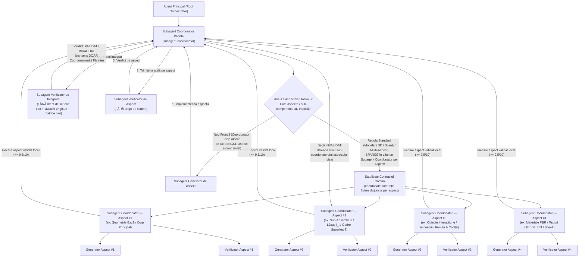

# AGENTS.md — Arhitectura de Orchestrare Multi-Agent pentru 3D Gaming

Acest document reprezintă constituția obligatorie a proiectului **`3d-gaming`** (`/Users/petreleon/code/3d-gaming`). Orice sarcină de dezvoltare, modelare 3D, animație, fizică, shadere sau interfață se execută printr-o ierarhie strictă formată din **3 roluri de subagenți**:

1. **Subagenți Coordonatori** (`subagent-coordonator`) — **Câte un Subagent Coordonator dedicat per aspect / sub-componentă!**
2. **Subagenți Generatori** (`subagent-generator`, `generator-modelare-3d`, `generator-animatii-3d`, `generator-gameplay-cod`)
3. **Subagenți Verificatori** (`subagent-verificator`, `verificator-modelare-3d`, `verificator-animatii-3d`, `verificator-gameplay-cod`)

---

## 📎 Documentație Detaliată și Scripturi de Audit

- **[`docs/agents/01-arhitectura-si-decizie-coordonator.md`](./docs/agents/01-arhitectura-si-decizie-coordonator.md)** — Diagrama decizională a Coordonatorului, descompunerea obligatorie pe aspecte (câte un sub-coordonator per aspect) și bucla de mediere.
- **[`docs/agents/02-specializari-generatori-si-verificatori.md`](./docs/agents/02-specializari-generatori-si-verificatori.md)** — Matricea de specializări și șablonul obligatoriu al **Fișei de Specializare** transmise de Coordonatori către Generatori și Verificatori.
- **[`docs/agents/03-protocol-verificare-si-matrice-animatii.md`](./docs/agents/03-protocol-verificare-si-matrice-animatii.md)** — Regulile Verificatorului exigent (Read-Only pe proiect) și metodologia de spargere a animațiilor într-o matrice de imagini ($R \times C$).
- **[`scripts/capture_animation_matrix.mjs`](./scripts/capture_animation_matrix.mjs)** — Script automatizat Puppeteer/WebGL pentru spargerea animațiilor Three.js într-o matrice $R \times C$ de imagini etichetate temporal și pentru capturi statice multi-unghi.
- **[`scripts/blender_animation_matrix.py`](./scripts/blender_animation_matrix.py)** — Script Blender pentru randarea și compunerea unei animații într-o matrice $R \times C$ de imagini.

---

## 🏛️ 1. Arhitectura Celor 3 Roluri și Descompunerea Obligatorie pe Aspecte



---

## 🚨 2. REGULA DE FIER PENTRU MODELAREA 3D: Câte un `subagent-coordonator` per Aspect!

> **INTERDICȚIE DE MONOLITIZARE A MODELĂRII 3D:**
> Este **STRICT INTERZIS** ca un `subagent-coordonator` părinte să trateze crearea unui model 3D complet (fie el un obiect industrial/CAD `.3mf`, un fruct/element organic, un personaj sau o piesă de recuzită) ca pe un „task atomic” dat unui singur Generator monolitic!
> Atunci când un singur Generator primește simultan geometria bazei, geometria elementelor de sprijin/retenție, sub-ansamblurile secundare, materialele PBR, exportul `.3mf` și integrarea în scenă, detaliile geometrice individuale (ex. forma exactă `|_|` vs. `V`, oprirea în partea superioară, proporțiile bazei sau orientarea sub-componentelor) se amestecă și nu sunt izolate și verificate suficient de riguros.

### Descompunerea Obligatorie a Oricărui Task de Modelare 3D în Subagenți Coordonatori pe Aspecte:

La primirea unui task de modelare 3D, **Subagentul Coordonator Părinte** stabilește mai întâi **Contractul Geometric Comun** (sistemul de axe, unitățile în milimetri/scenă, planul mesei $y = 0$, interfețele TypeScript și fișierele disjuncte `src/<obiect>/<aspect>.ts`), apoi **deschide câte un `subagent-coordonator` copil dedicat pentru fiecare aspect distinct**:

1. **`subagent-coordonator` — Aspectul 1: Geometria Structurii de Bază / Corpului Primar (`src/<obiect>/baseGeometry.ts`)**
   - Răspunde exclusiv de infrastructura de sprijin pe sol ($y = 0$), amprenta tălpii, puntea mediană dintre capete și extensia inferioară anti-dezechilibrare (sau volumul corporal primar al unui model organic).
   - Are propriul său `generator-modelare-3d` și propriul său `verificator-modelare-3d` care auditează exclusiv proporțiile, lățimea, planeitatea la $y=0$ și continuitatea $C^1/C^2$ a bazei.
2. **`subagent-coordonator` — Aspectul 2: Geometria Sprijinului / Lăcașului Frontal (`src/<obiect>/frontSupportGeometry.ts`)**
   - Răspunde exclusiv de forma geometrică exactă a pilonului/lăcașului frontal (ex. profilul dreptunghiular deschis **`|_|`** cu podea orizontală 100% plată `_` și pereți laterali verticali `|`, fără formă de `V`, sau sub-componenta anatomică/botanică superioară).
   - Verificat izolat în vedere frontală/profil (`side_profile`) și `wireframe` pentru a garanta fidelitatea 100% a profilului cerut.
3. **`subagent-coordonator` — Aspectul 3: Geometria Opritorului Posterior & Retenției Superioare (`src/<obiect>/rearStopperGeometry.ts`)**
   - Răspunde exclusiv de mecanismul posterior de oprire și imobilizare (ex. peretele opritor din spate + puntea/oprirea solidă în partea superioară `Upper Stopper Roof Bridge` în care se oprește capătul de coadă).
   - Verificat izolat pentru absența auto-intersecțiilor, înălțimea plafonului de oprire și deschiderea tunelului.
4. **`subagent-coordonator` — Aspectul 4: Obiectele Secundare de Interacțiune / Accesorii / Sub-Componente (`src/<obiect>/accessoriesGeometry.ts`)**
   - Răspunde exclusiv de modelarea 3D a obiectelor care interacționează cu modelul principal sau a sub-componentelor atașate (ex. Lingura, Furculița și Cuțitul 3D așezate în suport, sau Frunza, Codița și Caliciul unui fruct), verificând matematic și vizual zero-clipping, garda igienică la sol și oprirea cozii sub plafonul superior.
5. **`subagent-coordonator` — Aspectul 5: Unificare Topologică 2-Manifold Watertight & Export CAD `.3mf` (`src/export3mf.ts`)**
   - Răspunde exclusiv de asamblarea/cusătura topologică fără muchii deschise (`boundaryEdgeCount = 0`, `nonManifoldEdgeCount = 0`, `rawSignedVolume > 0`), validarea matematică Euler-Poincaré și generarea fișierului fizic `.3mf`.
6. **`subagent-coordonator` — Aspectul 6: Materiale PBR, Iluminare Cinematografică, Cameră `setAuditPose` & UI (`src/<obiect>/materials.ts`, `src/main.ts`)**
   - Răspunde exclusiv de texturile procedurale FBM multi-octavă, shaderul PBR/SSS, iluminarea de studio, încadrarea perfectă în cele 6 unghiuri și matricea $4 \times 4$.

> **Notă privind Modificările Iterative Cerute de Utilizator:**
> Chiar și atunci când utilizatorul cere o modificare punctuală asupra unui aspect (de ex. *„vreau oprire în partea superioară la coadă”*, *„vreau partea inferioară lată”* sau *„vreau formă de `|_|` în loc de `V`”*), Coordonatorul Părinte deleagă modificarea către **Subagentul Coordonator al aspectului vizat** (care își rulează Generatorul + Verificatorul de aspect), urmată de re-verificarea integrării ansamblului!

---

## 👥 3. Rolurile Detaliate ale Celor 3 Categorii de Subagenți

### A. Subagentul Coordonator (`subagent-coordonator`)
1. **Descompunerea pe Aspecte (La nivel de Coordonator Părinte):**
   - Evaluează toate aspectele geometrice, mecanice, vizuale și de cod ale cerinței.
   - Dacă taskul implică modelare 3D sau $\ge 2$ aspecte distincte, **sparge obligatoriu taskul în câte un `subagent-coordonator` copil per aspect** (Opțiunea B), stabilind în prealabil contractul comun de coordonate și fișiere disjuncte.
   - Deschide direct `Generator + Verificator` (Opțiunea A) **doar** atunci când el însuși este deja un **Subagent Coordonator alocat pe un singur aspect atomic izolat**.
2. **Transmiterea specializărilor:**
   - Înzestrează fiecare Sub-Coordonator, Generator și Verificator cu **Fișa de Specializare** exactă a aspectului său.
3. **Medierea buclei de validare și Verificarea de Integrare:**
   - După ce toți Subagenții Coordonatori de aspect au obținut `STATUS: VALIDAT` de la verificatorii lor locali, Coordonatorul Părinte își invocă propriul **Subagent Verificator de Integrare** pentru auditul ansamblului complet.

### B. Subagentul Generator (`subagent-generator` și variantele specializate)
1. **Rol:** Agent frunză de execuție (`EnableWriteTools: true`, `EnableSubagentTools: false`, `EnableMCPTools: true`), dedicat **unui singur aspect** alocat de Coordonatorul său de aspect.
2. **Specializare primită de la Coordonator:** Aplică strict legile matematice, geometrice, cinematice și arhitecturale din **Fișa de Specializare**.
3. **Izolarea fișierelor:** Modifică exclusiv fișierele aspectului alocat de Coordonatorul său.
4. **Remediere fără scurtături:** Când primește de la Coordonatorul său de aspect obiecțiile Verificatorului, rezolvă fiecare defect matematic, de cod sau vizual și raportează Coordonatorului.

### C. Subagentul Verificator (`subagent-verificator` și variantele specializate)
1. **NU scrie niciodată direct în proiect:**
   - Uneltele `write_file` și `edit_file` sunt eliminate din configurația Verificatorilor (`.agents/agents/verificator*.md`).
   - Verificatorul **nu modifică niciodată codul sursă, modelele 3D sau testele** (nici direct, nici prin comenzi shell) și nu repară singur bugurile.
2. **Transmite rezultatul EXCLUSIV către Subagentul Coordonator:**
   - Verificatorul **nu comunică niciodată direct cu Generatorul**. Orice raport (`STATUS: VALIDAT` sau `STATUS: INVALIDAT` + tabelul de defecte) este trimis numai Subagentului Coordonator care l-a deschis.
3. **Exigență Extremă & Prezumția de Respingere Vizuală (Toleranță Zero, Prag Minim `9.5 / 10`):**
   - **Dogma de Fier („Guilty Until Proven Pixar / Photorealistic / CAD Masterpiece”):** Trecerea testelor de cod (`tsc --noEmit`, `vitest run`) și a invarianților matematici ($\min(y)=0$, fără piese flotante) reprezintă **doar 20% din verificare**! Verificatorul pornește de la prezumția că randarea are defecte vizuale sau abateri de formă față de cerința utilizatorului (ex. profil în `V` în loc de `|_|`, lipsa opririi superioare, bază îngustată artificial, dungi sintetice $\sin(N\theta)$, back-face culling) și **invalidează nemilos** orice abatere.
   - **Verificare Vizuală & Estetică Multi-Unghi (15 Legi Draconice + Tabel Obligatoriu de Scorare `9.5 / 10`):** Capturează și inspectează cu `view_file` (`read_file`) randări din **minimum 6 unghiuri** (`front`, `three_quarter`, `side_profile`, `left_profile`, `back`, `top` + `close-up` pe aspectul verificat) în mod `material` și `wireframe`, acordând note pe 5 axe estetice și funcționale (prag minim `9.5 / 10` pe fiecare axă).
   - **Verificarea Animațiilor prin Matrice de Imagini ($R \times C$):** Sparge orice animație într-o matrice $4 \times 4$ (16 cadre) cu [`scripts/capture_animation_matrix.mjs`](./scripts/capture_animation_matrix.mjs) sau [`scripts/blender_animation_matrix.py`](./scripts/blender_animation_matrix.py) și inspectează vizual fiecare celulă `#00 .. #15`.

---

## 🗂️ 4. Catalogul Subagenților Disponibili în Workspace (`.agents/agents/`)

| Nume Subagent (`TypeName`) | Categorie | Drept de Scriere Proiect | Poate Deschide Subagenți | Specializare Principală |
| :--- | :--- | :---: | :---: | :--- |
| [`subagent-coordonator`](./.agents/agents/subagent-coordonator.md) | **Coordonator** (Părinte sau de Aspect) | Doar contracte / coordonare | **DA** (`Coordonatori per Aspect`, `Generatori`, `Verificatori`) | Spargere obligatorie a modelării 3D în câte un sub-coordonator per aspect, injectare specializări, mediere buclă de validare. |
| [`subagent-generator`](./.agents/agents/subagent-generator.md) | **Generator** (Polimorfic) | **DA** | NU | Primește specializarea dinamică a aspectului de la Coordonator (cod, 3D, animații, shadere, UI). |
| [`subagent-verificator`](./.agents/agents/subagent-verificator.md) | **Verificator** (Polimorfic) | **NU (Interzis)** | NU | Primește specializarea aspectului de la Coordonator; audit exigent de cod, vizual multi-unghi și matrice de animații; raportează doar Coordonatorului. |
| [`generator-modelare-3d`](./.agents/agents/generator-modelare-3d.md) | **Generator** (Specializat) | **DA** | NU | Sculptură și geometrie 3D pe aspectul alocat (Three.js & Blender), topologie $C^1$/2-manifold, profile exacte (`|_|`, elipsoide, capsule). |
| [`verificator-modelare-3d`](./.agents/agents/verificator-modelare-3d.md) | **Verificator** (Specializat) | **NU (Interzis)** | NU | Audit criminalistic & estetic draconic pe aspect și pe ansamblu în **15 legi + Tabel Scorare `9.5 / 10`** pe 6+ unghiuri (`material` + `wireframe`). |
| [`generator-animatii-3d`](./.agents/agents/generator-animatii-3d.md) | **Generator** (Specializat) | **DA** | NU | Rigging, cinematică FK/IK, animații fluide pe arce, contact $y=0$, hook `setAuditPose`. |
| [`verificator-animatii-3d`](./.agents/agents/verificator-animatii-3d.md) | **Verificator** (Specializat) | **NU (Interzis)** | NU | Spargerea animației în **Matrice de Imagini ($R \times C$)**, audit vizual cadru-cu-cadru și **Tabel Scorare `9.5 / 10`**. |
| [`generator-gameplay-cod`](./.agents/agents/generator-gameplay-cod.md) | **Generator** (Specializat) | **DA** | NU | Arhitectură TypeScript/WebGL, fizică/coliziuni cu `delta`, export `.3mf`, shadere, UI și teste unitare/integrare. |
| [`verificator-gameplay-cod`](./.agents/agents/verificator-gameplay-cod.md) | **Verificator** (Specializat) | **NU (Interzis)** | NU | Audit filozofie cod, `tsc --noEmit`, performanță GPU (`dispose()`), invarianți și calitatea testelor. |

---

## 🔬 5. Contractul Tehnic pentru Verificarea Vizuală și Matricea de Animații

Pentru ca **Verificatorii de Aspect** și **Verificatorul de Integrare** să poată inspecta determinist orice aspect/sub-componentă 3D și să poată sparge orice animație într-o matrice de imagini $R \times C$, scenele Three.js / WebGL create de **Generatori** trebuie să expună în `window.__gameStage` (sau `window.__childStage`) metoda `setAuditPose`:

```ts
interface AuditPoseConfig {
  action?: string;   // Numele acțiunii sau al aspectului izolat (ex. 'idle', 'print_ready', 'spoon', 'fork', 'knife', 'turntable')
  t?: number;        // Timpul exact în secunde (ex. t_k = t_0 + (k / (N - 1)) * T)
  theta?: number;    // Azimutul camerei în radiani (0 = față +Z, π/2 = profil, π = spate)
  phi?: number;      // Elevația camerei în radiani
  radius?: number;   // Distanța camerei față de țintă
  targetY?: number;  // Înălțimea punctului privit pe axa Y
}

declare global {
  interface Window {
    __gameStage?: {
      setAuditPose: (cfg: AuditPoseConfig) => void;
    };
  }
}
```
