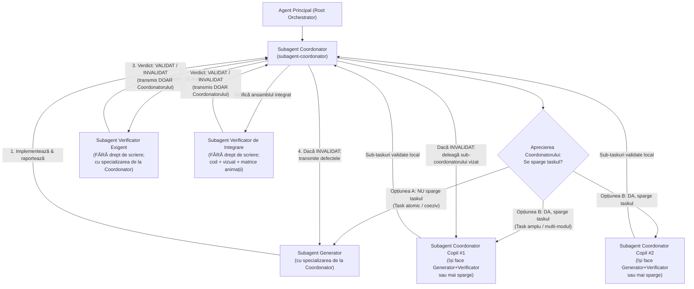

# AGENTS.md — Arhitectura de Orchestrare Multi-Agent pentru 3D Gaming

Acest document reprezintă constituția obligatorie a proiectului **`3d-gaming`** (`/Users/petreleon/code/3d-gaming`). Orice sarcină de dezvoltare, modelare 3D, animație, fizică, shadere sau interfață se execută printr-o ierarhie strictă formată din **3 roluri de subagenți**:

1. **Subagenți Coordonatori** (`subagent-coordonator`)
2. **Subagenți Generatori** (`subagent-generator`, `generator-modelare-3d`, `generator-animatii-3d`, `generator-gameplay-cod`)
3. **Subagenți Verificatori** (`subagent-verificator`, `verificator-modelare-3d`, `verificator-animatii-3d`, `verificator-gameplay-cod`)

---

## 📎 Documentație Detaliată și Scripturi de Audit

- **[`docs/agents/01-arhitectura-si-decizie-coordonator.md`](./docs/agents/01-arhitectura-si-decizie-coordonator.md)** — Diagrama decizională a Coordonatorului (execuție directă vs. spargere recursivă în sub-coordonatori) și bucla de mediere.
- **[`docs/agents/02-specializari-generatori-si-verificatori.md`](./docs/agents/02-specializari-generatori-si-verificatori.md)** — Matricea de specializări și șablonul obligatoriu al **Fișei de Specializare** transmise de Coordonatori către Generatori și Verificatori.
- **[`docs/agents/03-protocol-verificare-si-matrice-animatii.md`](./docs/agents/03-protocol-verificare-si-matrice-animatii.md)** — Regulile Verificatorului exigent (Read-Only pe proiect) și metodologia de spargere a animațiilor într-o matrice de imagini ($R \times C$).
- **[`scripts/capture_animation_matrix.mjs`](./scripts/capture_animation_matrix.mjs)** — Script automatizat Puppeteer/WebGL pentru spargerea animațiilor Three.js într-o matrice $R \times C$ de imagini etichetate temporal și pentru capturi statice multi-unghi.
- **[`scripts/blender_animation_matrix.py`](./scripts/blender_animation_matrix.py)** — Script Blender pentru randarea și compunerea unei animații într-o matrice $R \times C$ de imagini.

---

## 🏛️ 1. Arhitectura Celor 3 Roluri și Fluxul de Decizie



### A. Subagentul Coordonator (`subagent-coordonator`)
1. **Aprecierea autonomă a descompunerii taskului:**
   - La primirea unui task, Subagentul Coordonator evaluează complexitatea, numărul de componente și gradul de cuplare.
   - **Opțiunea A (Execuție Directă — Generator + Verificator):** Dacă taskul este atomic și bine delimitat (ex. un singur model 3D, o singură animație, un singur shader sau 1–3 fișiere strâns legate), Coordonatorul **nu mai sparge taskul în alți coordonatori**, ci deschide direct **un Generator** și **un Verificator** cu specializările potrivite.
   - **Opțiunea B (Descompunere Recursivă — Subagenți Coordonatori + Verificator):** Dacă taskul este complex sau multidisciplinar (ex. o scenă cu mai multe personaje/obiecte, mediu, animații multiple, fizică și UI), Coordonatorul stabilește mai întâi contractul comun (interfețe TypeScript, scări, pivoți `(0,0,0)` și granițe disjuncte de fișiere), apoi deschide **alți Subagenți Coordonatori copii** (în paralel pentru părțile independente) **și propriul său Subagent Verificator** pentru validarea integrării finale.
2. **Transmiterea specializărilor:**
   - Coordonatorul este responsabil să înzestreze atât Generatorul, cât și Verificatorul cu **specializările necesare** (fie invocând variantele specializate predefinite, fie definind subagenți dedicați cu `define_subagent` și transmițând **Fișa de Specializare** în prompt).
3. **Medierea buclei de validare:**
   - Coordonatorul primește raportul de la Verificator. Dacă verdictul este `STATUS: INVALIDAT`, Coordonatorul transmite lista exactă de defecte către Generator (în Opțiunea A) sau către Subagentul Coordonator copil responsabil (în Opțiunea B), apoi re-invocă Verificatorul până la obținerea `STATUS: VALIDAT`.

### B. Subagentul Generator (`subagent-generator` și variantele specializate)
1. **Rol:** Agent frunză de execuție (`EnableWriteTools: true`, `EnableSubagentTools: false`, `EnableMCPTools: true`).
2. **Specializare primită de la Coordonator:** Aplică strict legile matematice, geometrice, cinematice și arhitecturale din **Fișa de Specializare** primită de la Coordonator.
3. **Izolarea fișierelor:** Modifică exclusiv fișierele alocate de Coordonatorul său.
4. **Remediere fără scurtături:** Când primește de la Coordonator obiecțiile Verificatorului, rezolvă fiecare defect matematic, de cod sau vizual (inclusiv pe cadrele `#k` indicate din matricea de imagini a animației) și raportează Coordonatorului.

### C. Subagentul Verificator (`subagent-verificator` și variantele specializate)
1. **NU scrie niciodată direct în proiect:**
   - Uneltele `write_file` și `edit_file` sunt eliminate din configurația Verificatorilor (`.agents/agents/verificator*.md`).
   - Verificatorul **nu modifică niciodată codul sursă, modelele 3D sau testele** (nici direct, nici prin comenzi shell) și nu repară singur bugurile.
2. **Transmite rezultatul EXCLUSIV către Subagentul Coordonator:**
   - Verificatorul **nu comunică niciodată direct cu Generatorul**. Orice raport (`STATUS: VALIDAT` sau `STATUS: INVALIDAT` + tabelul de defecte) este trimis numai Subagentului Coordonator care l-a deschis.
3. **Exigență Extremă & Prezumția de Respingere Vizuală (Toleranță Zero, Prag Minim `9.5 / 10`):**
   - **Dogma de Fier („Guilty Until Proven Pixar / Photorealistic Masterpiece”):** Trecerea testelor de cod (`tsc --noEmit`, `vitest run`) și a invarianților matematici ($\min(y)=0$, fără piese flotante) reprezintă **doar 20% din verificare**! Verificatorul pornește de la prezumția că randarea are defecte vizuale și **invalidează nemilos** orice rezultat care arată artificial, rigid, din plastic ieftin, cu dungi trigonometrice sintetice $\sin(N\theta)$, cu siluetă pătrățoasă/de ardei gras în loc de măr rotund, cu inele speculare albe sau cu detalii/frunze invizibile din profil.
   - **Verificare de Cod:** Citește integral fișierele cu `read_file`, rulează `npx tsc --noEmit`, linterul și testele, verifică absența `any`, absența scurgerilor de memorie GPU (`dispose()`), folosirea corectă a `delta` time, absența dungilor sintetice $\sin(K\theta)$ pe obiecte organice și calitatea testelor.
   - **Verificare Vizuală & Estetică Multi-Unghi (15 Legi Draconice + Tabel Obligatoriu de Scorare `9.5 / 10`):** Capturează și inspectează cu `read_file` randări din **minimum 6 unghiuri** (`front`, `three_quarter`, `side_profile`, `left_profile`, `back`, `top` + `close-up`) în mod `material` și `wireframe`, aplicând cele 15 Legi Draconice și acordând note pe 5 axe estetice:
     1. *Fidelitatea Siluetei & Proporții Naturale* ($\ge 9.5 / 10$);
     2. *Organicitatea Suprafeței & Texturii (Noise Multi-Octavă, Zero Dungi Sintetice)* ($\ge 9.5 / 10$);
     3. *Realismul Materialului PBR / Subsurface Scattering (SSS) & Reflexii* ($\ge 9.5 / 10$);
     4. *Expresivitatea, Volumul 3D & Lizibilitatea Sub-Componentelor din toate cele 6 unghiuri* ($\ge 9.5 / 10$);
     5. *Iluminare Cinematografică, Umbră de Contact & Contrast cu Fundalul* ($\ge 9.5 / 10$).
     Dacă **oricare** notă este sub **`9.5 / 10`**, Verificatorul este obligat să emită **`STATUS: INVALIDAT`**!
   - **Verificarea Animațiilor prin Matrice de Imagini (OBLIGATORIU la animații):**
     - La orice animație, Verificatorul **sparge animația într-o matrice de imagini ($R \times C$ cadre ordonate temporal, ex. $4 \times 4 = 16$ cadre)** folosind [`scripts/capture_animation_matrix.mjs`](./scripts/capture_animation_matrix.mjs) (pentru Three.js/WebGL) sau [`scripts/blender_animation_matrix.py`](./scripts/blender_animation_matrix.py) (pentru Blender).
     - Apoi **inspectează vizual matricea de imagini cu `read_file`** (din cel puțin 2 unghiuri: `three_quarter` și `side_profile`), verificând fiecare celulă `#00 .. #(N-1)` și tranzițiile dintre ele pentru:
       1. Continuitatea arcelor de mișcare (fără salturi/pops sau gimbal flip);
       2. Absența cadrelor înghețate (dead frames);
       3. Absența clipping-ului/interpenetrării în posturile extreme;
       4. Integritatea articulațiilor la flexie maximă (fără goluri la coate/genunchi);
       5. Contactul ferm cu solul la $y = 0$ (fără foot-sliding sau scufundare în podea);
       6. Închiderea lină a buclei (`#(N-1)` $\rightarrow$ `#00`) și prezența mișcării secundare (anticipație, follow-through / overlap).

---

## 🗂️ 2. Catalogul Subagenților Disponibili în Workspace (`.agents/agents/`)

| Nume Subagent (`TypeName`) | Categorie | Drept de Scriere Proiect | Poate Deschide Subagenți | Specializare Principală |
| :--- | :--- | :---: | :---: | :--- |
| [`subagent-coordonator`](./.agents/agents/subagent-coordonator.md) | **Coordonator** | Doar contracte / coordonare | **DA** (`Coordonatori`, `Generatori`, `Verificatori`) | Triaj task (spargere recursivă vs. execuție directă), injectare specializări, mediere buclă de validare. |
| [`subagent-generator`](./.agents/agents/subagent-generator.md) | **Generator** (Polimorfic) | **DA** | NU | Primește specializarea dinamică de la Coordonator (cod, 3D, animații, shadere, UI). |
| [`subagent-verificator`](./.agents/agents/subagent-verificator.md) | **Verificator** (Polimorfic) | **NU (Interzis)** | NU | Primește specializarea de la Coordonator; audit exigent de cod, vizual multi-unghi și matrice de animații; raportează doar Coordonatorului. |
| [`generator-modelare-3d`](./.agents/agents/generator-modelare-3d.md) | **Generator** (Specializat) | **DA** | NU | Sculptură și geometrie 3D (Three.js & Blender), topologie $C^1$, atașare pe elipsoid, capsule articulații. |
| [`verificator-modelare-3d`](./.agents/agents/verificator-modelare-3d.md) | **Verificator** (Specializat) | **NU (Interzis)** | NU | Audit criminalistic & estetic draconic în **15 legi + Tabel Scorare `9.5 / 10`** pe 6+ unghiuri (`material` + `wireframe`). |
| [`generator-animatii-3d`](./.agents/agents/generator-animatii-3d.md) | **Generator** (Specializat) | **DA** | NU | Rigging, cinematică FK/IK, animații fluide pe arce, contact $y=0$, hook `setAuditPose`. |
| [`verificator-animatii-3d`](./.agents/agents/verificator-animatii-3d.md) | **Verificator** (Specializat) | **NU (Interzis)** | NU | Spargerea animației în **Matrice de Imagini ($R \times C$)**, audit vizual cadru-cu-cadru și **Tabel Scorare `9.5 / 10`**. |
| [`generator-gameplay-cod`](./.agents/agents/generator-gameplay-cod.md) | **Generator** (Specializat) | **DA** | NU | Arhitectură TypeScript/WebGL, fizică/coliziuni cu `delta`, shadere, UI și teste unitare/integrare. |
| [`verificator-gameplay-cod`](./.agents/agents/verificator-gameplay-cod.md) | **Verificator** (Specializat) | **NU (Interzis)** | NU | Audit filozofie cod, `tsc --noEmit`, performanță GPU (`dispose()`), invarianți și calitatea testelor. |

> [!TIP]
> Pe lângă cei 9 subagenți predefiniți, orice **`subagent-coordonator`** poate apela `define_subagent` pentru a crea pe loc perechi hiper-specializate de `generator-<domeniu>` și `verificator-<domeniu>` (de ex. pentru vehicule, apă/fluide, particule, iluminare cinematică sau fizică ragdoll), respectând întotdeauna regula că Verificatorul nu scrie niciodată direct și raportează exclusiv Coordonatorului.

---

## 🔬 3. Contractul Tehnic pentru Verificarea Vizuală și Matricea de Animații

Pentru ca **Verificatorii** să poată inspecta determinist orice model 3D și să poată sparge orice animație într-o matrice de imagini $R \times C$, scenele Three.js / WebGL create de **Generatori** trebuie să expună în `window.__gameStage` (sau `window.__childStage`) metoda `setAuditPose`:

```ts
interface AuditPoseConfig {
  action?: string;   // Numele animației (ex. 'idle', 'walk', 'run', 'attack', 'jump')
  t?: number;        // Timpul exact în secunde (ex. t_k = t_0 + (k / (N - 1)) * T)
  theta?: number;    // Azimutul camerei în radiani (0 = față +Z, π/2 = profil, π = spate)
  phi?: number;      // Elevația camerei în radiani
  radius?: number;   // Distanța camerei față de țintă
  targetY?: number;  // Înălțimea punctului privit pe axa Y
}

declare global {
  interface Window {
    __gameStage?: {
      setAuditPose: (cfg: AuditPoseConfig) => void;
    };
  }
}
```

### Comenzi Standard folosite de Subagenții Verificatori

```bash
# 1. Spargerea unei animații WebGL într-o matrice 4x4 (16 cadre) din 2 unghiuri (three_quarter + side_profile)
node scripts/capture_animation_matrix.mjs \
  --mode matrix \
  --url http://localhost:3000 \
  --action walk \
  --start 0 \
  --duration 1.6 \
  --rows 4 \
  --cols 4 \
  --views three_quarter,side_profile \
  --out /tmp/animation-matrix

# 2. Captură multi-unghi (6 unghiuri + matrice 2x3) pentru auditul geometric al unui model 3D static
node scripts/capture_animation_matrix.mjs \
  --mode angles \
  --url http://localhost:3000 \
  --action idle \
  --out /tmp/visual-audit

# 3. Spargerea unei animații Blender într-o matrice 4x4 (16 cadre)
blender -b <scena.blend> -P scripts/blender_animation_matrix.py -- \
  --action walk --start 1 --end 48 --rows 4 --cols 4 --out /tmp/animation-matrix
```

După rularea comenzii, **Verificatorul** deschide obligatoriu cu `read_file` fișierele `matrix_*.png` generate și examinează vizual fiecare celulă a matricei înainte de a emite `STATUS: VALIDAT` sau `STATUS: INVALIDAT` către **Subagentul Coordonator**.
