# AGENTS.md — Arhitectura de Orchestrare Multi-Agent pentru 3D Gaming & Inginerie Software

Acest document reprezintă constituția obligatorie a proiectului **`3d-gaming`** (`/Users/petreleon/code/3d-gaming`) atât pentru **Modelare 3D, Geometrie CAD `.3mf`, Animații, Shadere și Scene Vizuale**, cât și pentru **Arhitectură Software, Gameplay, Motoare de Stare (FSM/ECS), Fizică Deterministă, Parsere/I/O și UI/UX**. Orice sarcină de dezvoltare, arhitectură software, modelare 3D, animație, fizică, shadere sau interfață se execută printr-o ierarhie strictă formată din **3 roluri de subagenți**, guvernată de **Protocolul Draconic Anti-Lene în 10 Legi**:

1. **Subagenți Coordonatori** (`subagent-coordonator`) — **Câte un Subagent Coordonator dedicat per aspect 3D sau strat arhitectural software!**
2. **Subagenți Generatori** (`subagent-generator`, `generator-modelare-3d`, `generator-animatii-3d`, `generator-gameplay-cod`)
3. **Subagenți Verificatori / Evaluatori Red-Team** (`subagent-verificator`, `verificator-modelare-3d`, `verificator-animatii-3d`, `verificator-gameplay-cod`)

---

## 📎 Documentație Detaliată și Scripturi de Audit

- **[`docs/agents/01-arhitectura-si-decizie-coordonator.md`](./docs/agents/01-arhitectura-si-decizie-coordonator.md)** — Diagrama decizională a Coordonatorului, descompunerea obligatorie pe aspecte 3D și straturi software (câte un sub-coordonator per aspect/strat) și bucla de mediere.
- **[`docs/agents/02-specializari-generatori-si-verificatori.md`](./docs/agents/02-specializari-generatori-si-verificatori.md)** — Matricea de specializări și șablonul obligatoriu al **Fișei de Specializare** transmise de Coordonatori către Generatori și Verificatori / Evaluatori Red-Team.
- **[`docs/agents/03-protocol-verificare-si-matrice-animatii.md`](./docs/agents/03-protocol-verificare-si-matrice-animatii.md)** — Regulile Verificatorului exigent (Read-Only pe proiect) și metodologia de spargere a animațiilor într-o matrice de imagini ($R \times C$).
- **[`docs/agents/04-arhitectura-software-generator-evaluator-si-anti-lene.md`](./docs/agents/04-arhitectura-software-generator-evaluator-si-anti-lene.md)** — Arhitectura software în 5 straturi disjuncte (*Clean/Hexagonal Architecture* + *Pure Functional Core / Imperative Shell*), bucla adversarială *Generator $\leftrightarrow$ Coordonator $\leftrightarrow$ Red-Team Evaluator* și Protocolul Coercitiv Anti-Lene în 10 Legi.
- **[`scripts/capture_animation_matrix.mjs`](./scripts/capture_animation_matrix.mjs)** — Script automatizat Puppeteer/WebGL pentru spargerea animațiilor Three.js într-o matrice $R \times C$ de imagini etichetate temporal și pentru capturi statice multi-unghi.
- **[`scripts/blender_animation_matrix.py`](./scripts/blender_animation_matrix.py)** — Script Blender pentru randarea și compunerea unei animații într-o matrice $R \times C$ de imagini.

---

## 🏛️ 1. Arhitectura Celor 3 Roluri și Descompunerea Obligatorie pe Aspecte (Modelare 3D & Arhitectură Software)

```mermaid
flowchart TD
    Root["Agent Principal (Root Orchestrator)"] --> CoordRoot["Subagent Coordonator Părinte\n(subagent-coordonator)"]
    CoordRoot --> Triaj{"Analiza Domeniului & Aspectelor:\n3D Multi-Aspect, Arhitectură Software\nsau Nod Frunză Izolat?"}

    %% Ramura A: Modelare & Animație 3D (6 Aspecte Disjuncte)
    Triaj -- "Ramura A (Modelare & Animație 3D):\nSPARGE în câte un Sub-Coordonator per Aspect 3D!" --> Contract3D["Contract Geometric Comun\n(axe, mm, y=0, fișiere disjuncte)"]
    Contract3D --> SubC3D_1["Subagent Coordonator — Aspect 3D #1\n(Bază / Corp Primar: baseGeometry.ts)"]
    Contract3D --> SubC3D_2["Subagent Coordonator — Aspect 3D #2\n(Sprijin Frontal |_| : frontSupportGeometry.ts)"]
    Contract3D --> SubC3D_3["Subagent Coordonator — Aspect 3D #3\n(Opritor Posterior & Plafon: rearStopperGeometry.ts)"]
    Contract3D --> SubC3D_4["Subagent Coordonator — Aspect 3D #4\n(Accesorii / Sub-Componente: accessoriesGeometry.ts)"]
    Contract3D --> SubC3D_5["Subagent Coordonator — Aspect 3D #5\n(2-Manifold Watertight & .3mf: export3mf.ts)"]
    Contract3D --> SubC3D_6["Subagent Coordonator — Aspect 3D #6\n(PBR, Lumini, setAuditPose & UI: materials.ts, main.ts)"]

    SubC3D_1 --> Gen3D_1["Generator 3D #1"] & Ver3D_1["Verificator 3D #1"]
    SubC3D_2 --> Gen3D_2["Generator 3D #2"] & Ver3D_2["Verificator 3D #2"]
    SubC3D_3 --> Gen3D_3["Generator 3D #3"] & Ver3D_3["Verificator 3D #3"]
    SubC3D_4 --> Gen3D_4["Generator 3D #4"] & Ver3D_4["Verificator 3D #4"]
    SubC3D_5 --> Gen3D_5["Generator 3D #5"] & Ver3D_5["Verificator 3D #5"]
    SubC3D_6 --> Gen3D_6["Generator 3D #6"] & Ver3D_6["Verificator 3D #6"]

    SubC3D_1 & SubC3D_2 & SubC3D_3 & SubC3D_4 & SubC3D_5 & SubC3D_6 -- "Fiecare aspect 3D validat (>= 9.5/10)" --> CoordRoot
    CoordRoot -- "Audit ansamblu 3D" --> VerInt3D["Verificator de Integrare 3D\n(Read-Only: 6+ unghiuri + wireframe + matrice 4x4)"]
    VerInt3D -- "Verdict: VALIDAT / INVALIDAT\n(transmis DOAR Coordonatorului Părinte)" --> CoordRoot

    %% Ramura B: Arhitectură Software & Inginerie Cod (5 Straturi Arhitecturale Disjuncte)
    Triaj -- "Ramura B (Arhitectură Software & Gameplay):\nSPARGE în câte un Sub-Coordonator per Strat Arhitectural!" --> ContractSW["Contract Arhitectural Software\n(tipuri, granițe Pure Core vs. Shell, fișiere disjuncte)"]
    ContractSW --> SubCSW_1["Subagent Coordonator — Strat Software #1\n(Domain Model, Tipuri Algebrice & Contracte: types.ts)"]
    ContractSW --> SubCSW_2["Subagent Coordonator — Strat Software #2\n(Pure Functional Core, FSM/ECS & Fizică: engine.ts)"]
    ContractSW --> SubCSW_3["Subagent Coordonator — Strat Software #3\n(Imperative Shell, I/O, .3mf & Resurse: io.ts)"]
    ContractSW --> SubCSW_4["Subagent Coordonator — Strat Software #4\n(Prezentare WebGL, Zero-Alloc Loop & Audit Hooks: view.ts)"]
    ContractSW --> SubCSW_5["Subagent Coordonator — Strat Software #5\n(Testare Adversarială, Invarianți & E2E: *.test.ts)"]

    SubCSW_1 --> GenSW_1["Generator SW #1"] & EvalSW_1["Evaluator Software Red-Team #1"]
    SubCSW_2 --> GenSW_2["Generator SW #2"] & EvalSW_2["Evaluator Software Red-Team #2"]
    SubCSW_3 --> GenSW_3["Generator SW #3"] & EvalSW_3["Evaluator Software Red-Team #3"]
    SubCSW_4 --> GenSW_4["Generator SW #4"] & EvalSW_4["Evaluator Software Red-Team #4"]
    SubCSW_5 --> GenSW_5["Generator SW #5"] & EvalSW_5["Evaluator Software Red-Team #5"]

    SubCSW_1 & SubCSW_2 & SubCSW_3 & SubCSW_4 & SubCSW_5 -- "Fiecare strat software validat (>= 9.5/10)" --> CoordRoot
    CoordRoot -- "Audit integrare software" --> VerIntSW["Evaluator de Integrare Software\n(Read-Only: tsc + vitest + audit arhitectural & E2E)"]
    VerIntSW -- "Verdict: VALIDAT / INVALIDAT\n(transmis DOAR Coordonatorului Părinte)" --> CoordRoot

    %% Ramura C: Nod Frunză (Coordonator deja alocat pe UN SINGUR aspect/strat atomic izolat)
    Triaj -- "Ramura C (Nod Frunză: Coordonator deja alocat\npe UN SINGUR aspect/strat atomic izolat)" --> GenLeaf["Subagent Generator de Aspect/Strat"]
    GenLeaf -- "1. Implementează + Jurnal PoW" --> CoordRoot
    CoordRoot -- "2. Trimite la audit Red-Team" --> VerLeaf["Subagent Verificator / Evaluator Red-Team\n(FĂRĂ drept de scriere)"]
    VerLeaf -- "3. Verdict + Scorare (>= 9.5/10)" --> CoordRoot
```



---

## 🚨 2. REGULA DE FIER PENTRU MODELAREA 3D: Câte un `subagent-coordonator` per Aspect!

> **INTERDICȚIE DE MONOLITIZARE A MODELĂRII 3D:**
> Este **STRICT INTERZIS** ca un `subagent-coordonator` părinte să trateze crearea unui model 3D complet (fie el un obiect industrial/CAD `.3mf`, un fruct/element organic, un personaj sau o piesă de recuzită) ca pe un „task atomic” dat unui singur Generator monolitic!
> Atunci când un singur Generator primește simultan geometria bazei, geometria elementelor de sprijin/retenție, sub-ansamblurile secundare, materialele PBR, exportul `.3mf` și integrarea în scenă, detaliile geometrice individuale (ex. forma exactă `|_|` vs. `V`, oprirea în partea superioară, proporțiile bazei sau orientarea sub-componentelor) se amestecă și nu sunt izolate și verificate suficient de riguros.

### Descompunerea Obligatorie a Oricărui Task de Modelare 3D în Subagenți Coordonatori pe Aspecte:

La primirea unui task de modelare 3D, **Subagentul Coordonator Părinte** stabilește mai întâi **Contractul Geometric Comun** (sistemul de axe, unitățile în milimetri/scenă, planul mesei $y = 0$, interfețele TypeScript și fișierele disjuncte `src/<obiect>/<aspect>.ts`), apoi **deschide câte un `subagent-coordonator` copil dedicat pentru fiecare aspect distinct**:

1. **`subagent-coordonator` — Aspectul 1: Geometria Structurii de Bază / Corpului Primar (`src/<obiect>/baseGeometry.ts`)**
   - Răspunde exclusiv de infrastructura de sprijin pe sol ($y = 0$), amprenta tălpii, puntea mediană dintre capete și extensia inferioară anti-dezechilibrare (sau volumul corporal primar al unui model organic).
   - Are propriul său `generator-modelare-3d` și propriul său `verificator-modelare-3d` care auditează exclusiv proporțiile, lățimea, planeitatea la $y=0$ și continuitatea $C^1/C^2$ a bazei.
2. **`subagent-coordonator` — Aspectul 2: Geometria Sprijinului / Lăcașului Frontal (`src/<obiect>/frontSupportGeometry.ts`)**
   - Răspunde exclusiv de forma geometrică exactă a pilonului/lăcașului frontal (ex. profilul dreptunghiular deschis **`|_|`** cu podea orizontală 100% plată `_` și pereți laterali verticali `|`, fără formă de `V`, sau sub-componenta anatomică/botanică superioară).
   - Verificat izolat în vedere frontală/profil (`side_profile`) și `wireframe` pentru a garanta fidelitatea 100% a profilului cerut.
3. **`subagent-coordonator` — Aspectul 3: Geometria Opritorului Posterior & Retenției Superioare (`src/<obiect>/rearStopperGeometry.ts`)**
   - Răspunde exclusiv de mecanismul posterior de oprire și imobilizare (ex. peretele opritor din spate + puntea/oprirea solidă în partea superioară `Upper Stopper Roof Bridge` în care se oprește capătul de coadă).
   - Verificat izolat pentru absența auto-intersecțiilor, înălțimea plafonului de oprire și deschiderea tunelului.
4. **`subagent-coordonator` — Aspectul 4: Obiectele Secundare de Interacțiune / Accesorii / Sub-Componente (`src/<obiect>/accessoriesGeometry.ts`)**
   - Răspunde exclusiv de modelarea 3D a obiectelor care interacționează cu modelul principal sau a sub-componentelor atașate (ex. Lingura, Furculița și Cuțitul 3D așezate în suport, sau Frunza, Codița și Caliciul unui fruct), verificând matematic și vizual zero-clipping, garda igienică la sol și oprirea cozii sub plafonul superior.
5. **`subagent-coordonator` — Aspectul 5: Unificare Topologică 2-Manifold Watertight & Export CAD `.3mf` (`src/export3mf.ts`)**
   - Răspunde exclusiv de asamblarea/cusătura topologică fără muchii deschise (`boundaryEdgeCount = 0`, `nonManifoldEdgeCount = 0`, `rawSignedVolume > 0`), validarea matematică Euler-Poincaré și generarea fișierului fizic `.3mf`.
6. **`subagent-coordonator` — Aspectul 6: Materiale PBR, Iluminare Cinematografică, Cameră `setAuditPose` & UI (`src/<obiect>/materials.ts`, `src/main.ts`)**
   - Răspunde exclusiv de texturile procedurale FBM multi-octavă, shaderul PBR/SSS, iluminarea de studio, încadrarea perfectă în cele 6 unghiuri și matricea $4 \times 4$.

> **Notă privind Modificările Iterative Cerute de Utilizator:**
> Chiar și atunci când utilizatorul cere o modificare punctuală asupra unui aspect (de ex. *„vreau oprire în partea superioară la coadă”*, *„vreau partea inferioară lată”* sau *„vreau formă de `|_|` în loc de `V`”*), Coordonatorul Părinte deleagă modificarea către **Subagentul Coordonator al aspectului vizat** (care își rulează Generatorul + Verificatorul de aspect), urmată de re-verificarea integrării ansamblului!

---

## 🏗️ 3. EXTINDEREA LA NIVEL DE ARHITECTURĂ SOFTWARE: Cascada Coordonator & Bucla Adversarială Generator–Evaluator (`Software Architecture Generator–Evaluator Loop`)

### 3.1. Interdicția de Monolitizare Software

> **INTERDICȚIE DE MONOLITIZARE A ARHITECTURII SOFTWARE:**
> Este **STRICT INTERZIS** ca un `subagent-coordonator` părinte să delege un sistem software non-trivial (cu $\ge 2$ straturi arhitecturale, module funcționale sau responsabilități distincte) unui singur Generator monolitic care amestecă tipurile de domeniu, logica de business/fizică, operațiile I/O, randarea WebGL și testele într-un singur fișier sau modul cuplat strâns (*spaghetti code*).
> Orice subsistem software trebuie proiectat prin separarea riguroasă **Clean / Hexagonal Architecture** și **Pure Functional Core / Imperative Shell**, unde fiecare strat arhitectural este guvernat de propriul său `subagent-coordonator` și verificat la sânge de un **Evaluator Software Red-Team** independent.

### 3.2. Descompunerea Obligatorie a Arhitecturii Software în 5 Subagenți Coordonatori pe Straturi Disjuncte

La primirea unui task de inginerie software / gameplay / motoare de simulare / procesare CAD, **Subagentul Coordonator Părinte** definește **Contractul Arhitectural Software** (interfețele dintre straturi, direcția unidirecțională a dependențelor și proprietatea exclusivă asupra fișierelor), apoi deschide câte un `subagent-coordonator` dedicat pentru fiecare strat relevant:

1. **Strat Software #1 — `subagent-coordonator`: Domain Model, Tipuri Algebrice, Contracte & Invarianți (`src/<modul>/types.ts`, `contracts.ts`)**
   - Răspunde exclusiv de modelarea domeniului prin **Type-Driven Design** și uniuni discriminate TypeScript (`Discriminated Unions`), făcând stările ilegale nereprezentabile în sistemul de tipuri (*make illegal states unrepresentable*).
   - Definește interfețele imutabile (`readonly`), tipurile algebrice `Result<T, E>`, structurile de date de domeniu, constantele fizice/geometrice și contractele de pre-condiții, post-condiții și invarianți matematici.
   - **Graniță de izolare:** Zero dependențe externe, zero importuri din Three.js/WebGL, DOM sau Node.js I/O.
2. **Strat Software #2 — `subagent-coordonator`: Core Business Logic, Algoritmi Puri, State Machines / ECS & Fizică Deterministă (`src/<modul>/engine.ts`, `stateMachine.ts`)**
   - Răspunde exclusiv de implementarea nucleului funcțional pur (**Pure Functional Core**): **zero dependențe** de DOM, `window`, `document`, Three.js/WebGL, rețea sau sistem de fișiere.
   - Implementează mașini de stări finite (FSM), arhitecturi Entity-Component-System (ECS) și transformări matematice/topologice **100% deterministe și reproductibile** la orice pas temporal $t$.
   - Asigură simularea fizică, detecția coliziunilor (BVH / spatial hashing / SAT) și cinematica independentă de framerate, scalată riguros cu `delta` time și sub-stepping determinist cu plafonare `Math.min(delta, MAX_DELTA)`.
   - Garantează complexitatea algoritmică optimă ($O(1)$ sau $O(N \log N)$), interzicând buclele $O(N^2)$ nejustificate pe colecții de vârfuri, triunghiuri sau entități.
3. **Strat Software #3 — `subagent-coordonator`: Infrastructură, I/O, Serializare Binară/XML/ZIP, Persistență & Gestiunea Resurselor (`src/<modul>/io.ts`, `export3mf.ts`)**
   - Răspunde exclusiv de învelișul imperativ (**Imperative Shell**): adaptoare de intrare/ieșire, generarea și validarea arhivelor CAD `.3mf` (XML + OPC ZIP), serializare/deserializare și parsere reziliente cu validare strictă de schemă la graniță.
   - Gestionează determinist ciclul de viață al resurselor CPU/GPU: metode `dispose()` complete pentru `BufferGeometry`, `Material`, `Texture`, `WebGLRenderTarget`, `AudioContext`, timere și `removeEventListener`.
   - Tratează explicit toate erorile prin tipuri `Result<T, E>` sau erori de domeniu puternic tipizate (zero blocuri `catch` goale sau excepții înghițite tăcut).
4. **Strat Software #4 — `subagent-coordonator`: Prezentare, Rendering Pipeline WebGL/Three.js, Shadere, Cameră & UI/UX (`src/<modul>/view.ts`, `main.ts`)**
   - Răspunde exclusiv de proiecția vizuală și interacțiunea cu utilizatorul, păstrând o decuplare unidirecțională strictă: stratul de prezentare citește starea din `Pure Functional Core` și o randează fără a scurge logica de business în callback-uri DOM sau în bucla `requestAnimationFrame`.
   - **Zero-Allocation Render Loop:** Este strict interzisă alocarea dinamică pe heap (`new THREE.Vector3()`, `new THREE.Matrix4()`, `new THREE.Quaternion()`, `new THREE.Color()`, `.clone()`, array-uri sau obiecte temporare) în interiorul buclei `requestAnimationFrame` — toate obiectele matematice auxiliare se pre-alocă o singură dată la nivel de modul sau clasă.
   - Expune obligatoriu hook-urile deterministe de inspecție `window.__gameStage.setAuditPose(cfg)` și `window.__gameStage.getStateSnapshot()`.
5. **Strat Software #5 — `subagent-coordonator`: Testare Adversarială, Invariant/Property Testing & Integrare E2E (`src/<modul>/<modul>.test.ts`)**
   - Răspunde exclusiv de construcția unei suite de teste Vitest de grad militar, proiectate adversarial pentru a sparge implementarea straturilor #1–#4.
   - Include obligatoriu: teste de invarianți matematici și topologici (Euler-Poincaré, conservarea energiei/volumului, determinisme la $t_k$), teste exhaustive pe toate tranzițiile permise și interzise ale mașinii de stări, teste pe valori limită (`0`, `-0`, `NaN`, `Infinity`, `Number.EPSILON`, unghiuri degenerate $0^\circ / 180^\circ$, colecții vide), teste de tip property/fuzzing și teste de verificare a eliberării complete a memoriei (`dispose()`).

### 3.3. Protocolul Buclei Adversariale Generator–Evaluator în Arhitectura Software (`Generator <-> Coordonator <-> Red-Team Evaluator`)

Fiecare strat software este dezvoltat și validat printr-o buclă adversarială strictă în 5 pași:

1. **Injectarea Fișei de Specializare Arhitecturală:** Coordonatorul de Strat transmite către `generator-gameplay-cod` (sau `subagent-generator`) contractul de tipuri, invarianții stratului, granița strictă de fișiere și cele 10 Legi Anti-Lene.
2. **Implementare Fără Scurtături & Auto-Audit PoW:** Generatorul implementează codul complet (fără stub-uri, mock-uri în producție sau omisiuni), rulează `npx tsc --noEmit` și `npx vitest run`, și trimite Coordonatorului raportul însoțit de **Jurnalul Proof-of-Work (PoW)**.
3. **Invocarea Evaluatorului Software Red-Team (100% Read-Only):** Coordonatorul de Strat invocă `verificator-gameplay-cod` (sau `subagent-verificator`) cu mandat de **Auditor Adversarial Red-Team**. Evaluatorul nu are drept de scriere în proiect.
4. **Auditul Criminalistic de Cod, Arhitectură și Teste:** Evaluatorul Red-Team inspectează integral fișierele stratului cu `view_file`, verifică direcția dependențelor (ex. `engine.ts` nu are voie să importe din `view.ts` sau `three`), caută orice încălcare a celor 10 Legi Anti-Lene, execută independent `npx tsc --noEmit` și `npx vitest run`, verifică puterea testelor contra *greenwashing*-ului și evaluează stratul conform **Tabelului Obligatoriu de Scorare Software pe 5 Axe**.
5. **Verdict și Buclă de Remediere Punct-cu-Punct:** Dacă oricare axă din tabel primește o notă `< 9.5 / 10` sau există fie și o singură încălcare a celor 10 Legi Anti-Lene, Evaluatorul returnează `STATUS: INVALIDAT` către Coordonator cu lista numerotată a defectelor (`fișier:linie`, cauza rădăcină, testul care lipsește). Coordonatorul retrimite lista Generatorului, care este obligat să rezolve 100% din obiecții și să livreze **Tabelul de Remediere Punct-cu-Punct**.

| # | Axă de Evaluare Arhitectură Software (Evaluator Red-Team) | Prag Minim | Ce se auditează la sânge |
| :- | :--- | :---: | :--- |
| **1** | **Decuplare Arhitecturală, Clean/Hexagonal Architecture & SOLID** | **`9.5 / 10`** | Separarea strictă *Pure Functional Core* vs. *Imperative Shell*, direcția unidirecțională a dependențelor, responsabilitate unică per modul, zero importuri circulare. |
| **2** | **Completitudine Anti-Lene (Zero TODO/Stub/Mock, Root-Cause Engineering)** | **`9.5 / 10`** | Zero cod trunchiat, zero `TODO`/`FIXME`, zero cârpeli simptomatice, tratarea exhaustivă a tuturor ramurilor și cazurilor limită. |
| **3** | **Siguranța Tipurilor (`tsc --noEmit`), Uniuni Discriminate & Determinism** | **`9.5 / 10`** | Zero `any` / `@ts-ignore`, modelarea stărilor prin uniuni discriminate, invarianți matematici/fizici garantați, independență de framerate (`delta`). |
| **4** | **Performanță, Complexitate Algoritmică & Gestiunea Memoriei (`dispose()`)** | **`9.5 / 10`** | Zero alocări pe heap în `requestAnimationFrame`, complexitate algoritmică optimă, eliberarea deterministă a resurselor WebGL/GPU și a listener-elor. |
| **5** | **Calitatea Adversarială a Testelor (Anti-Greenwashing & Edge-Case Coverage)** | **`9.5 / 10`** | Teste Vitest care verifică invarianți reali, limite numerice, intrări invalide, tranziții ilegale de stare și regresie (fără teste superficiale doar pe „happy path”). |

---

## ⚖️ 4. PROTOCOLUL DRACONIC ANTI-LENE („ZERO-LAZINESS / ZERO-SHORTCUT MANIFESTO”) — Cele 10 Legi Coercitive

Acest protocol interzice toate tiparele clasice de lene, superficialitate sau scurtături ale modelelor LLM în timpul generării și verificării. Orice abatere de la oricare dintre cele **10 Legi Coercitive** atrage automat verdictul **`STATUS: INVALIDAT`**!

1. **Legea #1 — Anti-Monolitizare (Decompoziție Obligatorie în Sub-Coordonatori per Aspect / Strat):**
   - **Manifestarea Interzisă (Tipar de Lene):** Un Coordonator Părinte sare peste spargerea în Sub-Coordonatori și trimite un model 3D complet sau o arhitectură software multi-strat unui singur Generator monolitic „ca să meargă mai repede”.
   - **Obligația Inginerească:** Orice task 3D se sparge în Sub-Coordonatori pe aspecte geometrice/vizuale, iar orice sistem software cu $\ge 2$ straturi/responsabilități se sparge în Sub-Coordonatori pe straturi arhitecturale disjuncte.
   - **Sancțiunea Automată:** `STATUS: INVALIDAT` imediat la auditul de arhitectură și refacerea completă prin Sub-Coordonatori dedicați.

2. **Legea #2 — Zero-Placeholder / Zero-TODO / Zero-Stub / Zero-Truncation:**
   - **Manifestarea Interzisă (Tipar de Lene):** Lăsarea în cod sau în documentație a comentariilor de amânare (`// TODO`, `// FIXME`, `// implement later`), a elipselor `...` în cod, documentație sau liste (`// ... rest of code remains the same`), a funcțiilor mock/stub în codul de producție sau a implementărilor parțiale „pentru demonstrație”.
   - **Obligația Inginerească:** Fiecare fișier scris sau editat trebuie să fie **100% complet, funcțional și de grad producție** de la prima până la ultima linie.
   - **Sancțiunea Automată:** `STATUS: INVALIDAT` instantaneu la orice detecție de cod incomplet sau trunchiat.

3. **Legea #3 — Read-Before-Write & Full Dependency Trace:**
   - **Manifestarea Interzisă (Tipar de Lene):** Modificarea unui fișier „în orb” fără citirea sa integrală prealabilă sau schimbarea unei semnături exportate fără a verifica toate modulele care o consumă.
   - **Obligația Inginerească:** Înaintea oricărui apel `edit_file` sau `write_file` pe un fișier existent, Generatorul este obligat să îl citească cu `view_file` și să traseze toate dependențele directe și inverse din workspace.
   - **Sancțiunea Automată:** `STATUS: INVALIDAT` pentru orice regresie de interfață sau suprascriere accidentală de cod existent.

4. **Legea #4 — Root-Cause Engineering (Interzicerea Cârpelilor Simptomatice & a Mascarării Erorilor):**
   - **Manifestarea Interzisă (Tipar de Lene):** Ascunderea erorilor de compilare sau de logică prin cast-uri forțate (`any`, `as unknown as T`), directive de suprimare (`@ts-ignore`, `@ts-expect-error`, `eslint-disable`), blocuri `try / catch` mute care înghit excepții sau constante magice de offset puse „din ochi” pentru a masca o formulă geometrică greșită.
   - **Obligația Inginerească:** Fiecare defect geometric, topologic, fizic sau arhitectural se rezolvă exclusiv la **cauza rădăcină** (recalcularea ecuației analitice, corectarea normalei, repararea cusăturii 2-manifold sau redesenarea uniunii discriminate).
   - **Sancțiunea Automată:** `STATUS: INVALIDAT` necondiționat la orice încercare de mascare a unei erori.

5. **Legea #5 — Exhaustive Edge-Case & Boundary Handling:**
   - **Manifestarea Interzisă (Tipar de Lene):** Scrierea algoritmilor care funcționează doar pentru valori „frumoase” și crapă sau produc `NaN` pe valori limită.
   - **Obligația Inginerească:** Orice funcție matematică, fizică, topologică sau I/O trebuie să trateze explicit și determinist cazurile limită: `0`, `-0`, valori negative, `NaN`, `Infinity`, `Number.EPSILON`, colecții goale, unghiuri degenerate ($0^\circ, 180^\circ$), vectori coliniari/nuli la normalizare, pierderea contextului WebGL și eliberarea memoriei prin `dispose()`.
   - **Sancțiunea Automată:** `STATUS: INVALIDAT` dacă Evaluatorul Red-Team identifică un singur caz limită netratat.

6. **Legea #6 — Anti-Greenwashing & Mutation-Grade Testing:**
   - **Manifestarea Interzisă (Tipar de Lene):** Scrierea de teste superficiale care verifică doar că o funcție nu aruncă eroare (`expect(res).toBeDefined()`) sau, și mai grav, slăbirea/ștergerea unei aserțiuni dintr-un test existent doar pentru ca suita `vitest` să iasă verde (*test greenwashing*).
   - **Obligația Inginerească:** Este strict interzisă relaxarea testelor! Fiecare test Vitest trebuie să aibă **putere de detecție a mutațiilor** (*mutation-grade*): să verifice invarianți numerici exacți, proprietăți geometrice/topologice, tranziții invalide și condiții de eroare, astfel încât orice alterare a logicii de producție să pice garantat testul.
   - **Sancțiunea Automată:** `STATUS: INVALIDAT` dacă testele sunt superficiale sau dacă un test existent a fost ocolit/îndulcit.

7. **Legea #7 — Adversarial Red-Team Evaluator Mindset („Guilty Until Proven Flawless”):**
   - **Manifestarea Interzisă (Tipar de Lene):** Un Verificator/Evaluator indulgent care acordă note de `9.8 / 10` din oficiu după o privire superficială sau doar pentru că `tsc` și `vitest` au trecut (*rubber-stamping*).
   - **Obligația Inginerească:** Orice Verificator / Evaluator operează ca un **Auditor Adversarial Red-Team** care pleacă de la prezumția că implementarea Generatorului este defectă și caută activ să demonstreze existența bugurilor de cod, a cuplării arhitecturale, a scurgerilor de memorie sau a abaterilor vizuale.
   - **Sancțiunea Automată:** Orice audit fără dovezi concrete și măsurători reale este respins de Coordonator.

8. **Legea #8 — Mandatory Proof-of-Work (PoW) Evidence Log:**
   - **Manifestarea Interzisă (Tipar de Lene):** Afirmații verbale neacoperite de dovezi, precum „am verificat toate fișierele și totul respectă cerințele”.
   - **Obligația Inginerească:** Fiecare raport al unui Generator sau Evaluator trebuie să conțină o secțiune **Jurnal Proof-of-Work (PoW)** care listează explicit: comenzile exacte rulate și output-ul lor (`npx tsc --noEmit`, `npx vitest run`, `diff -u`), fișierele și intervalele exacte de linii inspectate (`fișier:start-end`), valorile numerice ale invarianților și căile capturilor vizuale analizate cu `view_file`.
   - **Sancțiunea Automată:** `STATUS: INVALIDAT` pentru orice raport livrat fără Jurnal Proof-of-Work verificabil.

9. **Legea #9 — 100% Point-by-Point Remediation Table:**
   - **Manifestarea Interzisă (Tipar de Lene):** Când Evaluatorul raportează $N$ defecte, Generatorul repară doar primele 2–3 defecte ușoare și le ignoră pe restul, sperând că Evaluatorul nu va mai observa.
   - **Obligația Inginerească:** La fiecare iterație de remediere, Generatorul este obligat să rezolve **100% din cele $N$ obiecții** și să includă în răspunsul către Coordonator un **Tabel de Remediere Punct-cu-Punct** cu coloanele: `ID Defect | Cauza Rădăcină Identificată | Modificare Exactă (Fișier:Linii) | Test / Dovadă de Verificare`.
   - **Sancțiunea Automată:** `STATUS: INVALIDAT` instantaneu dacă lipsește fie și un singur punct din tabelul de remediere.

10. **Legea #10 — Real Tool Execution (Zero Textual Simulation / Zero Hallucination):**
    - **Manifestarea Interzisă (Tipar de Lene):** Simularea în text narativ a invocării subagenților, inventarea de ID-uri de conversație fictive sau pretinderea că testele/capturile au fost rulate fără apelarea reală a uneltelor.
    - **Obligația Inginerească:** Orice delegare către un subagent se face exclusiv prin apeluri reale `invoke_subagent` și `send_message`, orice comandă de verificare se execută real prin `run_command`, iar orice inspecție de fișier sau imagine se execută real prin `view_file`.
    - **Sancțiunea Automată:** Invalidarea imediată a execuției și reluarea obligatorie prin apeluri reale de unelte.

---

## 👥 5. Rolurile Detaliate ale Celor 3 Categorii de Subagenți

### A. Subagentul Coordonator (`subagent-coordonator`)
1. **Descompunerea pe Aspecte 3D și pe Straturi Arhitecturale Software (La nivel de Coordonator Părinte):**
   - Evaluează toate dimensiunile geometrice, mecanice, vizuale și arhitectural-software ale cerinței.
   - Pentru **Modelare & Animație 3D** (sau orice task cu $\ge 2$ aspecte 3D), **sparge obligatoriu taskul în câte un `subagent-coordonator` copil per aspect** (Secțiunea 2 — cele 6 aspecte 3D).
   - Pentru **Arhitectură Software, Gameplay, Fizică, Motoare de Stare sau I/O** (cu $\ge 2$ straturi sau responsabilități), **sparge obligatoriu taskul în câte un `subagent-coordonator` copil per strat arhitectural** (Secțiunea 3 — cele 5 straturi software).
   - Deschide direct `Generator + Verificator/Evaluator` **doar** atunci când el însuși este deja un **Subagent Coordonator alocat pe un singur aspect 3D sau pe un singur strat arhitectural software izolat** (Nod Frunză).
2. **Transmiterea Fișei de Specializare și a celor 10 Legi Anti-Lene:**
   - Înzestrează fiecare Sub-Coordonator, Generator și Verificator/Evaluator cu **Fișa de Specializare** exactă a aspectului/stratului său, granițele stricte de fișiere și exigențele celor 10 Legi Coercitive Anti-Lene.
3. **Medierea buclei adversariale de validare și Verificarea de Integrare:**
   - Verifică prezența **Jurnalului Proof-of-Work (PoW)** și a **Tabelului de Remediere Punct-cu-Punct** la fiecare iterație.
   - După ce toți Subagenții Coordonatori de aspect/strat au obținut `STATUS: VALIDAT` ($\ge 9.5 / 10$ pe toate axele) de la verificatorii/evaluatorii lor locali, Coordonatorul Părinte își invocă propriul **Subagent Verificator / Evaluator de Integrare** pentru auditul ansamblului complet.

### B. Subagentul Generator (`subagent-generator` și variantele specializate)
1. **Rol:** Agent frunză de execuție (`EnableWriteTools: true`, `EnableSubagentTools: false`, `EnableMCPTools: true`), dedicat **unui singur aspect 3D sau unui singur strat arhitectural software** alocat de Coordonatorul său.
2. **Specializare primită de la Coordonator & Respectarea celor 10 Legi Anti-Lene:** Aplică fără excepție legile matematice, geometrice, cinematice și arhitecturale din **Fișa de Specializare**, precum și cele **10 Legi Coercitive Anti-Lene** (Read-Before-Write, Zero-TODO/Stub, Root-Cause Engineering, Exhaustive Edge-Cases, Anti-Greenwashing).
3. **Izolarea fișierelor:** Creează sau modifică exclusiv fișierele aspectului/stratului alocat de Coordonatorul său.
4. **Livrare cu Jurnal Proof-of-Work (PoW) și Remediere 100% Punct-cu-Punct:** La finalizarea implementării livrează **Jurnalul PoW** complet; când primește obiecții de la Coordonator în urma auditului Red-Team, rezolvă 100% din obiecții la cauza rădăcină și livrează **Tabelul de Remediere Punct-cu-Punct**.

### C. Subagentul Verificator / Evaluator Red-Team (`subagent-verificator` și variantele specializate)
1. **NU scrie niciodată direct în proiect (100% Read-Only):**
   - Uneltele `write_file` și `edit_file` sunt eliminate din configurația Verificatorilor (`.agents/agents/verificator*.md`).
   - Verificatorul / Evaluatorul Red-Team **nu modifică niciodată codul sursă, modelele 3D, documentația sau testele** (nici direct, nici prin comenzi shell) și nu repară singur bugurile.
2. **Transmite rezultatul EXCLUSIV către Subagentul Coordonator:**
   - Verificatorul / Evaluatorul **nu comunică niciodată direct cu Generatorul**. Orice raport (`STATUS: VALIDAT` sau `STATUS: INVALIDAT` + tabelele de scorare și lista numerotată de defecte) este trimis numai Subagentului Coordonator care l-a invocat.
3. **Exigență Extremă & Prezumția Dublă de Respingere — Vizuală și Arhitectural-Software (Toleranță Zero, Prag Minim `9.5 / 10`):**
   - **Dogma de Fier Vizuală & 3D („Guilty Until Proven Pixar / Photorealistic / CAD Masterpiece”):** Trecerea testelor de cod (`tsc --noEmit`, `vitest run`) și a invarianților matematici ($\min(y)=0$, fără piese flotante) reprezintă **doar 20% din verificarea 3D**! Verificatorul pornește de la prezumția că randarea are defecte vizuale sau abateri de formă față de cerința utilizatorului (ex. profil în `V` în loc de `|_|`, lipsa opririi superioare, bază îngustată artificial, dungi sintetice $\sin(N\theta)$, back-face culling), inspectează cu `view_file` randări din **minimum 6 unghiuri** (`front`, `three_quarter`, `side_profile`, `left_profile`, `back`, `top` + `close-up`) în mod `material` și `wireframe` plus **matricea $4 \times 4$** pentru animații, și aplică **cele 15 Legi Draconice + Tabelul de Scorare Vizuală (`9.5 / 10`)**.
   - **Dogma de Fier Software & Arhitecturală („Adversarial Red-Team Software Evaluator”):** Pentru orice strat software, Evaluatorul Red-Team pornește de la prezumția că implementarea conține cuplare ascunsă între `Pure Core` și `Imperative Shell`, cazuri limită netratate, alocări pe heap în bucla de randare, scurgeri de memorie (`dispose()` incomplet) sau teste superficiale. Auditează codul linie cu linie cu `view_file`, verifică respectarea celor **10 Legi Coercitive Anti-Lene** și completează **Tabelul Obligatoriu de Scorare pentru Arhitectură Software pe 5 Axe (prag minim `9.5 / 10` pe fiecare axă)**.

---

## 🗂️ 6. Catalogul Subagenților Disponibili în Workspace (`.agents/agents/`)

| Nume Subagent (`TypeName`) | Categorie | Drept de Scriere Proiect | Poate Deschide Subagenți | Specializare Principală |
| :--- | :--- | :---: | :---: | :--- |
| [`subagent-coordonator`](./.agents/agents/subagent-coordonator.md) | **Coordonator** (Părinte, de Aspect 3D sau de Strat Software) | Doar contracte / coordonare | **DA** (`Coordonatori per Aspect/Strat`, `Generatori`, `Verificatori`) | Spargere obligatorie a modelării 3D în 6 aspecte și a arhitecturii software în 5 straturi disjuncte, injectarea Fișei de Specializare și a celor 10 Legi Anti-Lene, medierea buclei adversariale Generator–Evaluator. |
| [`subagent-generator`](./.agents/agents/subagent-generator.md) | **Generator** (Polimorfic) | **DA** | NU | Primește specializarea dinamică a aspectului 3D sau a stratului arhitectural software de la Coordonator; aplică cele 10 Legi Anti-Lene, livrează Jurnal PoW și Tabel de Remediere Punct-cu-Punct. |
| [`subagent-verificator`](./.agents/agents/subagent-verificator.md) | **Verificator / Evaluator Red-Team** (Polimorfic) | **NU (Interzis)** | NU | Primește specializarea aspectului 3D sau a stratului software de la Coordonator; execută audit Red-Team de arhitectură/cod, aplică cele 10 Legi Anti-Lene, audit vizual multi-unghi și matrice de animații; raportează doar Coordonatorului. |
| [`generator-modelare-3d`](./.agents/agents/generator-modelare-3d.md) | **Generator** (Specializat 3D) | **DA** | NU | Sculptură și geometrie 3D pe aspectul alocat (Three.js & Blender), topologie $C^1$/2-manifold watertight, profile exacte (`|_|`, punți de oprire, elipsoide, capsule), zero scurtături. |
| [`verificator-modelare-3d`](./.agents/agents/verificator-modelare-3d.md) | **Verificator Red-Team** (Specializat 3D) | **NU (Interzis)** | NU | Audit criminalistic & estetic draconic pe aspect și pe ansamblu în **15 Legi Vizuale + 10 Legi Anti-Lene + Tabel Scorare `9.5 / 10`** pe 6+ unghiuri (`material` + `wireframe`). |
| [`generator-animatii-3d`](./.agents/agents/generator-animatii-3d.md) | **Generator** (Specializat Animații) | **DA** | NU | Rigging fără Euler-twist, cinematică FK/IK deterministă, animații fluide pe arce cu anticipație și follow-through, contact $y=0$, hook `setAuditPose`. |
| [`verificator-animatii-3d`](./.agents/agents/verificator-animatii-3d.md) | **Verificator Red-Team** (Specializat Animații) | **NU (Interzis)** | NU | Spargerea animației în **Matrice de Imagini ($R \times C$)**, audit vizual cadru-cu-cadru `#00 .. #15`, verificarea celor 10 Legi Anti-Lene și **Tabel Scorare `9.5 / 10`**. |
| [`generator-gameplay-cod`](./.agents/agents/generator-gameplay-cod.md) | **Generator** (Specializat Arhitectură Software & Cod) | **DA** | NU | Arhitectură software pe straturi (*Type-Driven Domain*, *Pure Functional Core*, *Imperative Shell*, *Zero-Alloc WebGL View*), fizică deterministă cu `delta`, export `.3mf`, teste Vitest mutation-grade și respectarea celor 10 Legi Anti-Lene. |
| [`verificator-gameplay-cod`](./.agents/agents/verificator-gameplay-cod.md) | **Evaluator Red-Team** (Specializat Arhitectură Software & Cod) | **NU (Interzis)** | NU | Audit adversarial Red-Team pe arhitectura software (Clean/Hexagonal, SOLID, `Pure Core` vs. `Shell`), aplicarea celor 10 Legi Anti-Lene, `tsc --noEmit`, zero-alloc render loop, `dispose()`, anti-greenwashing pe teste și **Tabel Scorare Software `9.5 / 10`**. |

---

## 🔬 7. Contractul Tehnic pentru Verificarea Vizuală, Matricea de Animații și Inspecția Deterministă a Stării Software

Pentru ca **Verificatorii de Aspect**, **Evaluatorii Software Red-Team** și **Verificatorul de Integrare** să poată inspecta determinist orice aspect/sub-componentă 3D, să poată sparge orice animație într-o matrice de imagini $R \times C$ și să poată audita starea internă a nucleului software la orice pas temporal $t$, scenele și aplicațiile Three.js / WebGL create de **Generatori** trebuie să expună în `window.__gameStage` (sau `window.__childStage`) metodele `setAuditPose` și `getStateSnapshot`:

```ts
interface AuditPoseConfig {
  action?: string;   // Numele acțiunii sau al aspectului izolat (ex. 'idle', 'print_ready', 'spoon', 'fork', 'knife', 'turntable')
  t?: number;        // Timpul exact în secunde (ex. t_k = t_0 + (k / (N - 1)) * T)
  theta?: number;    // Azimutul camerei în radiani (0 = față +Z, π/2 = profil, π = spate)
  phi?: number;      // Elevația camerei în radiani
  radius?: number;   // Distanța camerei față de țintă
  targetY?: number;  // Înălțimea punctului privit pe axa Y
}

declare global {
  interface Window {
    __gameStage?: {
      setAuditPose: (cfg: AuditPoseConfig) => void;
      getStateSnapshot?: () => Readonly<Record<string, unknown>>;
    };
  }
}
```
