# Anexa 01 — Arhitectura Multi-Agent, Diagrama Decizională Unificată și Descompunerea pe Aspecte (`subagent-coordonator`)

Acest document definește arhitectura decizională obligatorie a ierarhiei recursive de subagenți (**Coordonatori Părinți**, **Coordonatori de Aspect / Strat**, **Generatori** și **Verificatori / Evaluatori**) în cadrul proiectului **3D Gaming** (`/Users/petreleon/code/3d-gaming`).

Pentru a elimina complet tendința agenților LLM către monolitizare, simplificări superficiale și scurtături cognitive („agent laziness”), arhitectura impune **descompunerea fractală pe aspecte izolate**: atât pentru **Modelarea 3D** (în 6 aspecte geometrice și vizuale distincte), cât și pentru **Arhitectura Software** (în 5 straturi arhitecturale inspirate din *Clean Architecture* și *Functional Core / Imperative Shell*).

---

## 1. Diagrama Decizională Unificată (Modelare 3D în 6 Aspecte + Arhitectură Software în 5 Straturi + Calea Frunză)

La primirea oricărui task, **Subagentul Coordonator** execută mai întâi triajul arhitectural conform diagramei de mai jos. Este **strict interzis** ca un Coordonator Părinte să aloce un model 3D complet sau un subsistem software multi-strat unui singur Generator monolitic.

```mermaid
flowchart TD
    Root["Agent Principal / Coordonator Părinte"] --> Coord["subagent-coordonator Părinte"]
    Coord --> Triaj{"Triajul Arhitectural al Taskului:\nCe tip de sistem / componentă dezvoltăm?"}

    %% RAMURA A: MODELARE 3D / SCENĂ 3D -> 6 ASPECTE OBLIGATORII
    Triaj -- "RAMURA A: MODELARE 3D / SCENĂ 3D\n(Spargere obligatorie în 6 Coordonatori de Aspect)" --> Contract3D["Stabilește Contractul Geometric Comun\n(Axe, cote în mm, planul mesei y = 0,\ninterfețe TypeScript, fișiere disjuncte)"]
    Contract3D --> C3D_1["subagent-coordonator — Aspect 3D #1\n(Structură Bază, Talpă y=0 & Punte Mediană)"]
    Contract3D --> C3D_2["subagent-coordonator — Aspect 3D #2\n(Sprijin Frontal & Profil Exact |_|)"]
    Contract3D --> C3D_3["subagent-coordonator — Aspect 3D #3\n(Opritor Posterior & Punte Superioară Închisă)"]
    Contract3D --> C3D_4["subagent-coordonator — Aspect 3D #4\n(Obiecte Interacțiune / Accesorii / Sub-Componente)"]
    Contract3D --> C3D_5["subagent-coordonator — Aspect 3D #5\n(Topologie 2-Manifold Watertight & Export .3mf)"]
    Contract3D --> C3D_6["subagent-coordonator — Aspect 3D #6\n(Materiale PBR/SSS, Iluminare & Cameră setAuditPose)"]

    C3D_1 --> G3D_1["Generator 3D #1"] & V3D_1["Verificator 3D #1"]
    C3D_2 --> G3D_2["Generator 3D #2"] & V3D_2["Verificator 3D #2"]
    C3D_3 --> G3D_3["Generator 3D #3"] & V3D_3["Verificator 3D #3"]
    C3D_4 --> G3D_4["Generator 3D #4"] & V3D_4["Verificator 3D #4"]
    C3D_5 --> G3D_5["Generator 3D #5"] & V3D_5["Verificator 3D #5"]
    C3D_6 --> G3D_6["Generator 3D #6"] & V3D_6["Verificator 3D #6"]

    C3D_1 & C3D_2 & C3D_3 & C3D_4 & C3D_5 & C3D_6 -- "Fiecare aspect 3D validat local\n(Scor >= 9.5/10 + Proof-of-Work)" --> AuditInt3D["Subagent Verificator de Integrare 3D\n(100% Read-Only; audit cod + 6 unghiuri\nmaterial/wireframe + matrice 4x4)"]
    AuditInt3D -- "STATUS: VALIDAT / INVALIDAT\n(raportat DOAR Coordonatorului Părinte)" --> Coord

    %% RAMURA B: ARHITECTURĂ SOFTWARE / FEATURE COMPLEX -> 5 STRATURI OBLIGATORII
    Triaj -- "RAMURA B: ARHITECTURĂ SOFTWARE / FEATURE COMPLEX\n(Spargere obligatorie în 5 Coordonatori de Strat)" --> ContractSW["Stabilește Contractul Arhitectural Comun\n(Branded Types, Discriminated Unions,\ninvarianți matematici, granițe de fișiere)"]
    ContractSW --> CSW_1["subagent-coordonator — Strat SW #1\n(Domain Model, Algebraic Types & Contracts)"]
    ContractSW --> CSW_2["subagent-coordonator — Strat SW #2\n(Pure Functional Core, State Machine & Physics)"]
    ContractSW --> CSW_3["subagent-coordonator — Strat SW #3\n(Imperative Infrastructure, I/O & .3mf Serialization)"]
    ContractSW --> CSW_4["subagent-coordonator — Strat SW #4\n(WebGL Presentation, Shaders, setAuditPose & UI)"]
    ContractSW --> CSW_5["subagent-coordonator — Strat SW #5\n(Adversarial E2E, Property & Invariant Testing)"]

    CSW_1 --> GSW_1["Generator SW #1"] & ESW_1["Evaluator SW #1"]
    CSW_2 --> GSW_2["Generator SW #2"] & ESW_2["Evaluator SW #2"]
    CSW_3 --> GSW_3["Generator SW #3"] & ESW_3["Evaluator SW #3"]
    CSW_4 --> GSW_4["Generator SW #4"] & ESW_4["Evaluator SW #4"]
    CSW_5 --> GSW_5["Generator SW #5"] & ESW_5["Evaluator SW #5"]

    CSW_1 & CSW_2 & CSW_3 & CSW_4 & CSW_5 -- "Fiecare strat validat local\n(Scor >= 9.5/10 pe 5 axe SW)" --> AuditIntSW["Subagent Evaluator de Integrare Software\n(100% Read-Only; audit arhitectural,\ntsc --noEmit, vitest run & E2E)"]
    AuditIntSW -- "STATUS: VALIDAT / INVALIDAT\n(raportat DOAR Coordonatorului Părinte)" --> Coord

    %% RAMURA C: CALEA FRUNZĂ (DOAR PENTRU UN SINGUR ASPECT ATOMIC DEJA IZOLAT)
    Triaj -- "RAMURA C: CALEA FRUNZĂ\n(Coordonator deja alocat pe UN SINGUR\naspect/strat atomic izolat)" --> LeafSpec["Injectează Fișa de Specializare\n+ Cele 10 Legi Anti-Lene"]
    LeafSpec --> LeafGen["Subagent Generator de Aspect\n(Implementare + Auto-Verificare + Proof-of-Work)"]
    LeafGen -- "Raport + Jurnal de Dovezi" --> Coord
    Coord -- "Trimite la audit independent" --> LeafVer["Subagent Verificator / Evaluator Adversarial\n(100% Read-Only; Red-Team Audit >= 9.5/10)"]
    LeafVer -- "STATUS: VALIDAT / INVALIDAT\n+ Tabel Defecte" --> Coord
    Coord -- "Dacă INVALIDAT: impune Tabelul de Remediere\n100% Punct-cu-Punct înainte de re-audit" --> LeafGen
```

---

## 2. Descompunerea Obligatorie pentru Modelare 3D (Cele 6 Aspecte 3D)

Atunci când un model 3D este tratat ca un bloc monolitic (un singur Generator pentru tot obiectul), apar inevitabil compromisuri de formă și topologie: un Generator care scrie simultan baza, profilul de sprijin frontal, opritorul posterior, accesoriile, materialele PBR și exportul `.3mf` tinde să simplifice sau să amestece formele (de ex. să folosească o șa în `V` în loc de profilul dreptunghiular `|_|`, să omită puntea superioară de oprire a cozii sau să îngusteze artificial baza).

Prin regula **„Câte un `subagent-coordonator` per aspect 3D”**, orice model 3D complex se împarte în următoarele **6 aspecte ortogonale**, cu fișiere disjuncte și verificări izolate:

| Aspect 3D & Coordonator Dedicat | Fișiere Deținute Exclusiv | Responsabilități Geometrice & Tehnice Exacte | Invarianți Matematici & Vizuali Obligatorii | Perechea `Generator <-> Verificator` |
| :--- | :--- | :--- | :--- | :--- |
| **Aspectul 3D #1: Structura de Bază, Talpa de Sprijin & Puntea Mediană** (`subagent-coordonator` #1) | `src/<obiect>/baseGeometry.ts` | Infrastructura de așezare pe masă ($y = 0$), amprenta lățită a tălpii pentru stabilitate mecanică, puntea mediană de legătură între pilonii față/spate și extensia inferioară anti-răsturnare (sau volumul corporal primar la modele organice). | • Contact ferm și coplanar pe masă: $\min(y) = 0.000\text{ mm}$ • Lățime generoasă anti-răsturnare pe axa $X$ • Continuitate $C^1/C^2$ la racordările cu pilonii • Zero auto-intersecții ale fețelor | `generator-modelare-3d` $\leftrightarrow$ `verificator-modelare-3d` (audit izolat pe planeitatea $y=0$, proporții și stabilitate) |
| **Aspectul 3D #2: Geometria Sprijinului / Lăcașului Frontal (`\|_\|`)** (`subagent-coordonator` #2) | `src/<obiect>/frontSupportGeometry.ts` | Geometria pilonului frontal și a lăcașului de susținere: profil dreptunghiular deschis **`\|_\|`** cu podea orizontală 100% plată (`_`) și pereți laterali verticali de ghidare (`\|`), sau sub-componenta anatomică/botanică frontală/superioară. | • **Fidelitate 100% a profilului `\|_\|`**: $\frac{\partial y}{\partial x} = 0$ pe toată lățimea podelei lăcașului (`_`) • Pereți laterali verticali simetrici la $x = \pm W_{\text{slot}}/2$ • Interdicție absolută a profilului în `V` sau concav rotunjit pe fundul lăcașului | `generator-modelare-3d` $\leftrightarrow$ `verificator-modelare-3d` (audit în `front`, `side_profile`, `close-up` și `wireframe`) |
| **Aspectul 3D #3: Geometria Opritorului Posterior & Retenției Superioare** (`subagent-coordonator` #3) | `src/<obiect>/rearStopperGeometry.ts` | Mecanismul posterior de imobilizare a cozii: pilonii laterali spate, peretele opritor posterior și **puntea/capota solidă închisă în partea superioară** (`Upper Stopper Roof Bridge`) sub care se blochează capătul cozii împotriva ridicării. | • Plafonul punții superioare la cota exactă $y_{\text{roof\_bottom}}$ deasupra cozii • Deschidere de tunel fără obstrucții pe axa $Z$ • Cusătură topologică 1-la-1 cu pereții laterali și peretele spate | `generator-modelare-3d` $\leftrightarrow$ `verificator-modelare-3d` (audit al tunelului, plafonului superior și absenței fețelor interne) |
| **Aspectul 3D #4: Obiecte Secundare de Interacțiune / Accesorii / Sub-Componente** (`subagent-coordonator` #4) | `src/<obiect>/accessoriesGeometry.ts` | Modelarea 3D autentică a obiectelor care interacționează cu suportul (ex. Lingura `spoon`, Furculița `fork` cu 4 dinți și Cuțitul `knife` așezate în suport) sau a sub-componentelor organice (frunză, codiță, caliciu). | • **Zero-clipping**: distanța semnată față de suport $\ge 0$ • Garda igienică la sol a părții active $\ge 15\text{ mm}$ deasupra mesei ($y=0$) • Contact fizic pe podeaua `\|_\|` și oprirea cozii sub plafonul punții superioare | `generator-modelare-3d` $\leftrightarrow$ `verificator-modelare-3d` (audit multi-unghi pentru fiecare accesoriu în parte) |
| **Aspectul 3D #5: Unificare Topologică 2-Manifold Watertight & Export CAD `.3mf`** (`subagent-coordonator` #5) | `src/export3mf.ts` | Asamblarea/cusătura topologică a tuturor secțiunilor într-un singur mesh închis 2-manifold (fără operații CSG brute cu crăpături), validarea Euler-Poincaré și generarea arhivei fizice OPC/ZIP `.3mf` pentru printare 3D. | • `boundaryEdgeCount === 0` (zero muchii deschise) • `nonManifoldEdgeCount === 0` (exact 2 triunghiuri pe muchie) • `rawSignedVolume > 0` (normale orientate spre exterior) • `degenerateTriangleCount === 0` | `generator-gameplay-cod` $\leftrightarrow$ `verificator-gameplay-cod` (audit matematic și verificare fișier `.3mf` pe disc) |
| **Aspectul 3D #6: Materiale PBR/SSS, Iluminare Cinematografică, Cameră `setAuditPose` & UI** (`subagent-coordonator` #6) | `src/<obiect>/materials.ts`, `src/main.ts` | Texturi procedurale FBM multi-octavă (fără dungi sintetice $\sin(N\theta)$), materiale PBR/SSS, iluminare de studio în 3 puncte cu *Rim Light*, umbră de contact moale, UI/HUD și expunerea `window.__gameStage.setAuditPose`. | • Texturi $\ge 1024 \times 1024$ cu `LinearMipmapLinearFilter` și anisotropie • Zero inele speculare albe în `top` și zero voal lăptos • `setAuditPose` funcțional pentru toate acțiunile și unghiurile | `subagent-generator` $\leftrightarrow$ `verificator-modelare-3d` (audit estetic în 6+ unghiuri și matrice $4 \times 4$, scor $\ge 9.5/10$) |

---

## 3. Descompunerea Obligatorie pentru Arhitectura Software (Cele 5 Aspecte / Straturi Software)

Pentru orice feature software complex, motor de simulare, sistem de gameplay, pipeline CAD sau arhitectură de aplicație, **Subagentul Coordonator Părinte** aplică arhitectura în 5 straturi (**Multi-Tier Software Architecture Cascade**), alocând **câte un `subagent-coordonator` dedicat pentru fiecare strat**:

| Strat Software & Coordonator Dedicat | Fișiere Deținute Exclusiv | Responsabilități Arhitecturale & Reguli de Inginerie | Invarianți Tehnici & Reguli de Dependență | Perechea `Generator <-> Evaluator` |
| :--- | :--- | :--- | :--- | :--- |
| **Aspectul Software #1: Domain Model, Tipuri Algebrice, Contracte & Invarianți** (`subagent-coordonator` SW #1) | `src/<modul>/types.ts`, `src/<modul>/contracts.ts` | Definirea ontologiei domeniului prin *Type-Driven Design*: *Branded Types* (`Millimeters`, `Radians`, `Seconds`), *Discriminated Unions* pentru toate stările și comenzile posibile, structuri imutabile `Readonly<T>`, tipul algebric `Result<T, E>` și constructori inteligenți care validează invarianții la graniță. | • **Zero dependențe externe** (fără importuri `three`, DOM, `fs` sau `window`) • **Zero `any`**, zero `as unknown as T`, zero `enum` nesigur • Stările ilegale sunt nereprezentabile în sistemul de tipuri | `generator-gameplay-cod` $\leftrightarrow$ `verificator-gameplay-cod` (audit pe expresivitatea tipurilor și completitudinea contractelor) |
| **Aspectul Software #2: Core Business Logic, Algoritmi Puri, State Machines / ECS & Fizică Deterministă** (`subagent-coordonator` SW #2) | `src/<modul>/engine.ts`, `src/<modul>/stateMachine.ts` | Implementarea *Pure Functional Core*: funcții 100% pure și deterministe de forma $f(\text{state}, \text{command}, \Delta t) \to \text{Result}\langle(\text{newState}, \text{events}), \text{DomainError}\rangle$, integrare numerică stabilă cu clamp pe $\Delta t \in [0, \Delta t_{\max}]$, detecție de coliziuni și calculul parametrilor geometrici. | • Depinde **exclusiv** de Stratul SW #1 (`types.ts`, `contracts.ts`) • **Zero efecte secundare**: fără `Math.random()` neînsămânțat, fără `Date.now()`, fără mutații globale sau apeluri WebGL/DOM • Exhaustivitate garantată prin `assertNever(x: never): never` | `generator-gameplay-cod` $\leftrightarrow$ `verificator-gameplay-cod` (audit de puritate funcțională, complexitate $O(N)$ și determinism matematic) |
| **Aspectul Software #3: Infrastructură, I/O, Serializare Binară/XML/ZIP (`.3mf`), Persistență & Gestiunea Resurselor** (`subagent-coordonator` SW #3) | `src/<modul>/io.ts`, `src/export3mf.ts` | Implementarea adaptoarelor de infrastructură (*Imperative Shell — I/O*): parsare defensivă a intrărilor externe, validarea topologică 2-manifold a geometriilor (`boundaryEdgeCount === 0`, `nonManifoldEdgeCount === 0`, `rawSignedVolume > 0`), împachetarea binară/ZIP a fișierelor `.3mf` și salvarea pe disc/browser. | • Depinde doar de Straturile SW #1 și SW #2 • Toate operațiile susceptibile de eșec returnează `Result<T, InfrastructureError>` (fără excepții necontrolate) • Validare strictă a integrității datelor înainte de scriere | `generator-gameplay-cod` $\leftrightarrow$ `verificator-gameplay-cod` (audit al robusteții I/O, conformității `.3mf` și tratării erorilor) |
| **Aspectul Software #4: Prezentare, Rendering Pipeline WebGL/Three.js, Shadere, Cameră `setAuditPose` & UI/UX** (`subagent-coordonator` SW #4) | `src/<modul>/view.ts`, `src/main.ts` | Sincronizarea stării din *Functional Core* cu scena Three.js/WebGL, bucla `requestAnimationFrame` fără alocări pe heap (*Zero-Allocation Loop*), eliberarea deterministă a memoriei GPU (`dispose()`), controalele UI și expunerea hook-urilor `window.__gameStage.setAuditPose` și `getStateSnapshot()`. | • **Zero `new THREE.Vector3/Matrix4/Quaternion/Color` în bucla de randare** (toate obiectele temporare sunt pre-alocate la nivel de modul/clasă) • `disposeHierarchy()` complet la demontare sau reconstrucție • Hook-uri de audit deterministe 100% funcționale | `subagent-generator` $\leftrightarrow$ `verificator-gameplay-cod` & `verificator-modelare-3d` (audit de memorie GPU, framerate și calitate vizuală) |
| **Aspectul Software #5: Testare Adversarială, Property/Invariant Testing & Integrare E2E** (`subagent-coordonator` SW #5) | `src/<modul>/<modul>.test.ts` | Construirea suitei de teste Vitest de grad militar (*Mutation-Grade & Property-Based Testing*): verificarea invarianților matematici și geometrici pe sute de combinații de parametri, testarea valorilor la limită (`0`, `-0`, `NaN`, `Infinity`, dimensiuni degenerate) și testarea fluxului complet cap-coadă. | • **Zero teste superficiale** (interzis `expect(x).toBeDefined()` ca unică aserțiune) • Orice mutație de semn (`+` $\leftrightarrow$ `-`, `<` $\leftrightarrow$ `<=`) în `engine.ts` trebuie să pice cel puțin un test • Rulare 100% verde în `npx vitest run` | `generator-gameplay-cod` $\leftrightarrow$ `verificator-gameplay-cod` (audit adversarial anti-greenwashing al testelor) |

### Detalierea Celor 5 Straturi Software

1. **Stratul #1 — Domain Model & Contracte Algebrice (`types.ts`, `contracts.ts`):**
   Acest strat constituie fundația imuabilă a modulului. Aici se definesc toate unitățile de măsură ca tipuri nominale (*Branded Types*, de ex. `Millimeters`, `Radians`, `Seconds`, `NormalizedRatio`), astfel încât compilatorul TypeScript să blocheze la compilare adunarea accidentală a milimetrilor cu radianii. Toate stările sistemului sunt modelate prin *Discriminated Unions* cu câmp discriminator explicit (`readonly kind: '...'`), eliminând complet combinațiile imposibile de flaguri booleene (`isLoading && hasError && isReady`).
2. **Stratul #2 — Pure Functional Core (`engine.ts`, `stateMachine.ts`):**
   Conține toată inteligența algoritmică, cinematică, fizică și geometrică în funcții matematice pure. Pentru aceleași argumente `(state, command, dt)`, funcția returnează garantat același obiect `newState` (fără a muta `state`-ul de intrare). Deoarece nu depinde de WebGL, DOM sau rețea, acest strat poate fi rulat și testat cu mii de iterații pe secundă în Node.js.
3. **Stratul #3 — Imperative Infrastructure & Serializare `.3mf` (`io.ts`, `export3mf.ts`):**
   Gestionează comunicarea cu lumea exterioară: citirea/scrierea fișierelor, generarea structurii XML 3MF (`3D/3dmodel.model`, `[Content_Types].xml`, `_rels/.rels`), împachetarea ZIP și auditul topologic al mesh-urilor. Orice input extern este tratat ca nesigur și validat prin scheme stricte înainte de a fi convertit în tipuri de domeniu.
4. **Stratul #4 — WebGL Presentation Pipeline & UI (`view.ts`, `main.ts`):**
   Este un strat subțire de proiecție vizuală care citește starea calculată de Stratul #2 și actualizează transformările, uniformele shaderelor și elementele DOM. Respectă cu strictețe disciplina **Zero-Allocation Real-Time Loop** și expune interfața de inspecție deterministă `window.__gameStage` (`setAuditPose` și `getStateSnapshot`) pentru auditul automatizat.
5. **Stratul #5 — Adversarial E2E & Property Testing (`*.test.ts`):**
   Scris de un subagent dedicat (separat de cel care a scris implementarea, sau auditat la sânge pentru a preveni testele autocomplezente), acest strat atacă sistemul cu cazuri limită, verifică conservarea energiei/volumului, testează planeitatea la $y=0$, verifică caracteristica Euler-Poincaré $\chi = V - E + F$ și garantează că nicio regresie nu poate trece neobservată.

---

## 4. Regula Canalului Unic de Comunicare și Protocolul de Control Anti-Lene al Coordonatorului asupra Buclei `Generator <-> Evaluator`

Pentru a preveni coluziunea tacită sau scăderea standardelor între agenți, comunicarea în triunghiul **Coordonator – Generator – Evaluator (Verificator)** este guvernată de reguli coercitive stricte:

### 4.1. Izolarea Completă Generator vs. Evaluator (Canal Unic prin Coordonator)
1. **Interdicția Comunicării Directe:** Generatorul și Evaluatorul **nu comunică niciodată direct între ei**. Toate mesajele trec exclusiv prin `subagent-coordonator`.
2. **Evaluatorul este 100% Read-Only pe Proiect:**
   - Uneltele `write_file` și `edit_file` sunt dezactivate în definiția tuturor Verificatorilor/Evaluatorilor (`.agents/agents/verificator-*.md`, `subagent-verificator.md`).
   - Evaluatorul are interdicție absolută de a modifica fișierele sursă ale proiectului prin comenzi shell (`sed`, `echo >`, `cat <<EOF`, `git checkout` etc.).
   - Dacă Evaluatorul găsește chiar și o singură abatere (un tip imprecis, un offset de $0.5\text{ mm}$, o muchie non-manifold sau o umbră lipsă), **nu o repară singur**, ci returnează `STATUS: INVALIDAT` către Coordonator.

### 4.2. Obligativitatea Jurnalului de Dovezi (`Proof-of-Work Evidence Log`) la Fiecare Raport
Subagentul Coordonator **respinge automat și fără excepție** orice raport primit de la un Generator sau de la un Evaluator dacă acesta nu conține secțiunea **`Proof-of-Work Evidence Log`** cu dovezi verificabile de execuție reală:
- **Pentru Generator:**
  - Lista exactă a fișierelor citite cu `view_file` înainte de modificare (*Read-Before-Write*);
  - Outputul real și complet al comenzii `npx tsc --noEmit` (zero erori de compilare);
  - Outputul real și complet al comenzii `npx vitest run` (numărul exact de suite și teste trecute);
  - Lista fișierelor create/modificate cu numărul de linii și bytes.
- **Pentru Evaluator (Verificator):**
  - Confirmarea citirii integrale (`view_file` cu intervalele exacte de linii `1..N`) a fiecărui fișier din scopul auditului;
  - Outputul propriei rulări independente a `npx tsc --noEmit` și `npx vitest run`;
  - Pentru aspecte 3D/vizuale/animații: căile absolute ale celor minimum 6 capturi statice (`material` + `wireframe`) și/sau ale matricelor $4 \times 4$, însoțite de observațiile vizuale extrase prin apelarea efectivă a `view_file` pe fiecare imagine PNG;
  - Tabelele oficiale de scorare completate cu note pe fiecare axă (prag minim obligatoriu `9.5 / 10`).

### 4.3. Obligativitatea Tabelului de Remediere Punct-cu-Punct (`100% Point-by-Point Remediation Table`)
Atunci când Evaluatorul returnează `STATUS: INVALIDAT` cu o listă de $K$ obiecții ($D_1, D_2, \dots, D_K$), **Subagentul Coordonator nu are voie să accepte o explicație narativă vagă de la Generator** (precum *„am rezolvat problemele semnalate”*).

Coordonatorul îi impune Generatorului să livreze în raportul de remediere **Tabelul de Remediere 100% Punct-cu-Punct**, având exact $K$ rânduri (câte unul pentru fiecare defect raportat de Evaluator):

| ID Defect (din raportul Evaluatorului) | Cauza Rădăcină Identificată (`Root Cause`) | Fișier & Interval de Linii Modificate | Soluția Matematică / Arhitecturală Aplicată | Test / Dovadă de Verificare că Defectul a Fost Eliminat |
| :--- | :--- | :--- | :--- | :--- |
| **`D-01`** | [ex. Folosirea unei parabole $y = a x^2$ pentru fundul lăcașului frontal în locwidth de segment orizontal constant] | `src/support/frontSupportGeometry.ts:L42-L78` | [ex. Înlocuit funcția parabolică cu profilul piecewise-linear exact `\|_\|`: $y(x) = y_{\text{floor}}$ pentru $\|x\| \le W_{\text{slot}}/2$ și pereți verticali la $\|x\| \in [W_{\text{slot}}/2, W_{\text{slot}}/2 + t_{\text{wall}}]$] | [ex. Testul `frontSupport.test.ts` verifică $\forall x \in [-9, 9], y(x) === 22.000\text{ mm}$; captura `side_profile` confirmă podeaua plată] |
| **`D-02`** | [ex. Alocare `new THREE.Vector3()` în interiorul buclei `animate()`] | `src/main.ts:L185-L214` | [ex. Pre-alocat vectorii `_tmpVecA` și `_tmpVecB` la nivel de modul și înlocuit apelurile cu `_tmpVecA.set(...)`] | [ex. Verificat prin `grep -n "new THREE\." src/main.ts` în interiorul `animate()` -> 0 apariții] |

Doar după ce Coordonatorul verifică faptul că toate cele $K$ puncte din tabel sunt completate cu modificări reale de cod și teste verzi, acesta re-invocă **Subagentul Evaluator** pentru un nou ciclu complet de verificare independentă.
