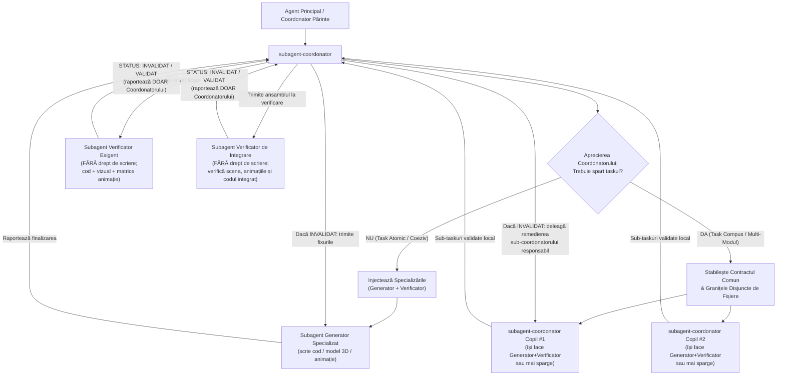

# Anexa 01 — Arhitectura Multi-Agent și Decizia Subagentului Coordonator

Acest document detaliază modul de funcționare al ierarhiei recursive de subagenți (**Coordonatori**, **Generatori** și **Verificatori**) în cadrul proiectului **3D Gaming**.

---

## 1. Diagrama Decizională a Subagentului Coordonator

Orice `subagent-coordonator` are două căi de acțiune, în funcție de aprecierea sa asupra complexității taskului primit:

---

## 2. Criterii de Apreciere: Când Sparge Coordonatorul Taskul?

| Dimensiune Evaluată | Calea A: Execuție Directă (`Generator` + `Verificator`) | Calea B: Spargerea Taskului (`Sub-Coordonatori` + `Verificator de Integrare`) |
| :--- | :--- | :--- |
| **Scopul taskului** | O singură unitate funcțională sau vizuală (ex. 1 personaj/obiect 3D, 1 animație, 1 shader, 1 sistem de coliziune). | Mai multe entități sau subsisteme distincte (ex. scenă completă cu mai multe personaje, decor, animații multiple, fizică și UI). |
| **Număr de fișiere** | 1–3 fișiere strâns cuplate. | $\ge 4$ fișiere sau module ce pot fi izolate fără coliziuni la scriere. |
| **Specializări necesare** | O singură specializare dominantă (ex. doar modelare 3D sau doar animație). | Specializări multiple care beneficiază de sub-coordonare dedicată (Modelare 3D + Animații 3D + Gameplay/Cod). |
| **Structura lansată de Coordonator** | 1 `Generator` specializat + 1 `Verificator` specializat. | $K \ge 2$ `subagent-coordonator` copii (în paralel/secvențial) + 1 `Verificator` de integrare la nivelul părintelui. |

---

## 3. Regula Canalului Unic de Comunicare (Triunghiul Coordonator–Generator–Verificator)

1. **Generatorul și Verificatorul nu comunică niciodată direct între ei.**
2. **Verificatorul este 100% Read-Only pe fișierele proiectului:**
   - Uneltele `write_file` și `edit_file` sunt eliminate din configurația Verificatorului.
   - Verificatorul nu repară niciodată singur un bug și nu modifică niciun fișier sursă.
   - Verificatorul își trimite raportul (`STATUS: VALIDAT` sau `STATUS: INVALIDAT` + tabelul de defecte) **exclusiv către Subagentul Coordonator**.
3. **Subagentul Coordonator este singurul mediator:**
   - Când primește `STATUS: INVALIDAT` de la Verificator, Coordonatorul extrage lista exactă de defecte (cod, geometrie 3D, sau cadrele `#k` cu probleme din matricea de imagini a animației) și le trimite prin `send_message` către **Generatorul** său (în Calea A) sau către **Subagentul Coordonator copil** responsabil (în Calea B).
   - După remediere, Coordonatorul îi cere aceluiași Verificator (prin `send_message`) să re-verifice integral modificările.
   - Taskul se închide **doar** când Verificatorul returnează `STATUS: VALIDAT` cu **0 defecte rămase**.
