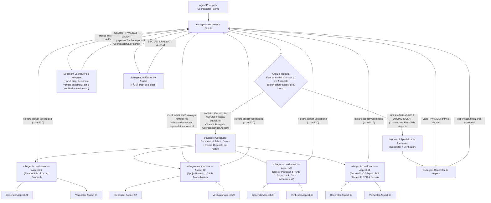

# Anexa 01 — Arhitectura Multi-Agent și Descompunerea Obligatorie pe Aspecte (`subagent-coordonator`)

Acest document detaliază modul de funcționare al ierarhiei recursive de subagenți (**Coordonatori Părinți**, **Coordonatori de Aspect**, **Generatori** și **Verificatori**) în cadrul proiectului **3D Gaming**.

---

## 1. Diagrama Decizională: Câte un `subagent-coordonator` per Aspect!

Orice task de modelare 3D sau dezvoltare multi-aspect se descompune obligatoriu astfel încât **fiecare aspect distinct să fie gestionat de propriul său `subagent-coordonator` copil**:

---

## 2. De ce Modelarea 3D Trebuie Spartă în Câte un Subagent Coordonator per Aspect?

Atunci când un model 3D este tratat ca un bloc monolitic (un singur Generator pentru tot obiectul), apar inevitabil compromisuri: un Generator care scrie simultan baza, profilul de sprijin, opritorul superior, accesoriile, materialele PBR și exportul `.3mf` tinde să simplifice sau să amestece formele (de ex. să folosească o șa în `V` în loc de `|_|`, să uite oprirea superioară la coadă sau să îngusteze greșit baza).

Prin regula **„Câte un `subagent-coordonator` per aspect”**:

| Nivel în Ierarhie | Responsabilitate | Ce Subagenți Deschide |
| :--- | :--- | :--- |
| **`subagent-coordonator` Părinte (Arhitectul Modelului 3D / Scenei)** | Definește contractul matematic în milimetri (axe, cote $x, y, z$, interfețe între părți, fișiere disjuncte) și împarte modelul 3D pe aspecte ortogonale. | Deschide **$K \ge 3$ `subagent-coordonator` copii (câte unul per aspect)** + **1 `Subagent Verificator de Integrare`** la final. |
| **`subagent-coordonator` de Aspect #1 (Bază & Echilibru)** | Coordonează exclusiv baza de așezare pe masă ($y=0$), lățimea tălpii, puntea mediană și extensia inferioară anti-dezechilibrare. | 1 `generator-modelare-3d` + 1 `verificator-modelare-3d` (dedicați exclusiv bazei). |
| **`subagent-coordonator` de Aspect #2 (Sprijin Frontal / Profil `\|_\|`)** | Coordonează exclusiv pilonul frontal și geometria lăcașului de sprijin (ex. podea 100% orizontală plată `_` și pereți verticali `\|`, zero formă de `V`). | 1 `generator-modelare-3d` + 1 `verificator-modelare-3d` (auditează strict profilul `\|_\|` în `side_profile` și `wireframe`). |
| **`subagent-coordonator` de Aspect #3 (Opritor Spate & Oprire Superioară)** | Coordonează exclusiv peretele opritor posterior și puntea/capota închisă în partea superioară (`Upper Stopper Roof Bridge`). | 1 `generator-modelare-3d` + 1 `verificator-modelare-3d` (auditează strict tunelul și plafonul de oprire). |
| **`subagent-coordonator` de Aspect #4 (Obiecte de Interacțiune / Sub-Componente)** | Coordonează modelarea tacâmurilor 3D (`spoon`, `fork`, `knife`) sau a sub-componentelor (frunză, codiță, sepale) și poziționarea lor fără clipping. | 1 `generator-modelare-3d` + 1 `verificator-modelare-3d` (auditează garda la sol și contactul exact). |
| **`subagent-coordonator` de Aspect #5 (Topologie 2-Manifold & Export `.3mf`)** | Coordonează unificarea mesh-ului watertight (`0` boundary edges, `rawSignedVolume > 0`), exportul `.3mf` și testele matematice. | 1 `generator-gameplay-cod` + 1 `verificator-gameplay-cod`. |
| **`subagent-coordonator` de Aspect #6 (Materiale PBR, Iluminare & Scenă)** | Coordonează texturile procedurale FBM, iluminarea de studio, camera `setAuditPose` și UI-ul. | 1 `subagent-generator` + 1 `verificator-modelare-3d`. |

---

## 3. Regula Canalului Unic de Comunicare (Triunghiul Coordonator–Generator–Verificator)

1. **Generatorul și Verificatorul nu comunică niciodată direct între ei.**
2. **Verificatorul este 100% Read-Only pe fișierele proiectului:**
   - Uneltele `write_file` și `edit_file` sunt eliminate din configurația Verificatorului.
   - Verificatorul nu repară niciodată singur un bug și nu modifică niciun fișier sursă.
   - Verificatorul își trimite raportul (`STATUS: VALIDAT` sau `STATUS: INVALIDAT` + tabelul de defecte) **exclusiv către Subagentul Coordonator care l-a invocat**.
3. **Izolarea Remedierilor pe Aspecte:**
   - Când utilizatorul sau Verificatorul de Integrare semnalează o problemă pe un anumit aspect (de ex. forma șeii de sprijin sau oprirea superioară), Coordonatorul Părinte nu rescrie tot proiectul, ci trimite cererea de remediere **strict către `subagent-coordonator`-ul aspectului vizat**, care își re-rulează bucla locală `Generator <-> Verificator` până la `STATUS: VALIDAT`.
