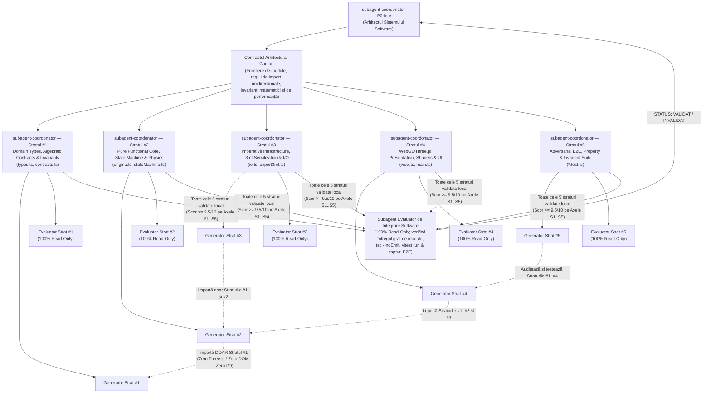
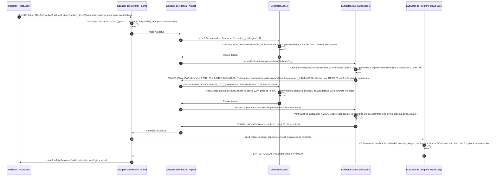

# Anexa 04 — Tratat de Arhitectură Software Multi-Tier (`Generator–Evaluator`) și Inginerie Coercitivă Anti-Lene (`Zero-Laziness Engineering`)

Acest document reprezintă tratatul tehnic de referință al proiectului **3D Gaming** (`/Users/petreleon/code/3d-gaming`) pentru proiectarea, implementarea și auditarea sistemelor software și a modelelor 3D de înaltă precizie printr-o arhitectură multi-agent bazată pe **Separarea Strictă Generator–Evaluator** și pe **Cele 10 Legi Coercitive Anti-Lene**.

---

## Capitolul 1: Anatomia Lenei Agenților LLM și Cele 10 Legi Coercitive Anti-Lene („Zero-Laziness Engineering”)

### 1.1. De ce Agenții LLM Nesupravegheați Tind spre Scurtături Cognitive?

Modelele de limbaj de scară largă (LLM) sunt antrenate statistic să maximizeze probabilitatea secvenței următoare de tokeni și să minimizeze efortul de generare atunci când constrângerile nu sunt formulate matematic și verificate adversarial. Într-un proiect complex de inginerie software și modelare 3D/CAD, această tendință naturală spre *plauzibilitate superficială* (în loc de *corectitudine structurală*) se manifestă prin zece patologii recurente:
1. **Comprimarea detaliilor într-un singur fișier monolitic**, unde cerințele geometrice fine (precum forma exactă `|_|` a unui lăcaș față de o șa în `V`, sau existența unei punți superioare de oprire) se diluează;
2. **Omisiuni tacite și cod parțial** (`// TODO`, `...`, funcții stub care returnează valori constante);
3. **Scrierea „în orb” fără citirea codului existent**, ceea ce distruge invarianții altor module;
4. **Cârpeala simptomelor în locul rezolvării cauzei rădăcină** (de ex., aplicarea lui `Math.abs(volume)` pentru a ascunde faptul că normalele unui mesh sunt orientate spre interior);
5. **Ignorarea cazurilor la limită** ($\Delta t = 0$, `NaN`, `Infinity`, diviziune prin zero la normalizarea unui vector nul);
6. **Teste unitare autocomplezente („Greenwashing Tests”)** care verifică doar `expect(mesh).toBeDefined()`;
7. **Autoevaluare îngăduitoare**, în care același agent care a scris codul îl declară „perfect”;
8. **Raportarea verbală a succesului fără rularea efectivă a compilatorului sau fără inspectarea vizuală a imaginilor generate**;
9. **Remedierea selectivă**, în care din 5 defecte raportate la audit sunt reparate doar 3, iar celelalte 2 sunt trecute sub tăcere;
10. **Halucinarea execuției uneltelor** (declararea că un fișier `.3mf` sau `.png` a fost generat fără verificarea lui pe disc).

### 1.2. Tabelul Comparativ Master al Celor 10 Tipare de Lene și Antidoturile Coercitive

| # | Tiparul de Lene al Agentului (`Failure Mode`) | Cum se Manifestă în Cod / Modelare 3D | Constrângerea din Prompt (`Antidotul Coercitiv`) | Metoda de Detecție a Evaluatorului Red-Team |
| :- | :--- | :--- | :--- | :--- |
| **1** | **Monolitizarea (`Monolithic Bloat`)** | Un singur agent scrie tot modelul 3D și toată aplicația într-un singur pas, amestecând baza, lăcașul `\|_\|`, opritorul spate, exportul `.3mf` și UI-ul. | **Legea 1:** Spargerea obligatorie în câte un `subagent-coordonator` per aspect (6 aspecte 3D / 5 straturi software) cu fișiere disjuncte. | Auditul structurii de directoare și al grafului de importuri; invalidare imediată dacă responsabilitățile sunt comasate. |
| **2** | **Truncarea și Omisiunea (`TODO / Stubs / Ellipsis`)** | Comentarii `// TODO`, `// restul codului rămâne neschimbat`, funcții care returnează `null` sau `{} as any`. | **Legea 2:** Politica *Zero-TODO / Zero-Stub / Zero-Placeholder*; cod 100% complet și compilabil. | Scanare automată `grep -rnE "TODO\|FIXME\|TBD\|placeholder"` + compilare strictă `npx tsc --noEmit`. |
| **3** | **Scrierea în Orb (`Blind Overwrite`)** | Modificarea unui fișier fără a citi semnăturile, coordonatele și invarianții deja existenți în proiect. | **Legea 3:** *Mandatory Read-Before-Write* — apelarea obligatorie a `view_file` înainte de orice `edit_file` / `write_file`. | Verificarea în `Proof-of-Work Evidence Log` a liniilor citite și verificarea compatibilității la integrare. |
| **4** | **Cârpeala Simptomatică (`Symptom Patching`)** | Folosirea `as any`, `@ts-ignore`, `try { ... } catch {}` gol sau `Math.abs(rawSignedVolume)` pentru a forța un test să treacă. | **Legea 4:** *Root-Cause Engineering* — interzicerea măștilor cosmetice și obligativitatea demonstrării matematice a fixului. | Inspecție linie-cu-linie a diff-ului și penalizare automată sub `6.5 / 10` pe Axa S2/S3 pentru orice mască. |
| **5** | **Orbirea la Cazurile Limită (`Happy-Path Bias`)** | Algoritmi care funcționează doar pentru valori „frumoase”, dar produc `NaN` la $\Delta t = 0$, vectori coliniari sau unghiuri de $0 / \pi$. | **Legea 5:** Tratarea exhaustivă a frontierelor matematice ($\Delta t \in [0, \Delta t_{\max}]$, $\varepsilon = 10^{-9}$, `assertNever`). | Teste adversariale cu valori extreme (`0`, `-0`, `NaN`, `Infinity`, dimensiuni degenerate). |
| **6** | **Teste Formale Masluite (`Test Greenwashing`)** | Teste care apelează o funcție și verifică doar `expect(res).toBeTruthy()` fără a verifica coordonatele sau topologia. | **Legea 6:** *Mutation-Grade & Property-Based Testing* — fiecare test trebuie să verifice invarianți matematici exacți. | Auditul de mutație mentală: Evaluatorul verifică dacă schimbarea unui semn în `engine.ts` pică testul. |
| **7** | **orbirea Autocomplezentă (`Self-Confirmation Bias`)** | Agentul crede că modelul arată bine deoarece codul compilează, fără a observa că profilul este în `V` în loc de `\|_\|`. | **Legea 7:** Dogma *Guilty Until Proven Masterpiece* și pragul draconic minim `9.5 / 10` pe fiecare axă. | Captură multi-unghi (6+ vederi `material` + `wireframe` și matrice $4 \times 4$) inspectată cu `view_file`. |
| **8** | **Afirmații fără Dovezi (`Unverified Claims`)** | Rapoarte de tipul „Am rulat testele și totul funcționează” fără outputul real din consolă. | **Legea 8:** Obligativitatea *Jurnalului de Dovezi (`Proof-of-Work Evidence Log`)* în fiecare raport. | Coordonatorul respinge automat orice raport fără outputul exact al comenzilor și lista fișierelor inspectate. |
| **9** | **Remedierea Parțială (`Selective Amnesia`)** | La primirea a 4 defecte de la Evaluator, Generatorul repară 2 și le ignoră pe celelalte 2. | **Legea 9:** *Tabelul de Remediere 100% Punct-cu-Punct (`Point-by-Point Remediation Matrix`)*. | Coordonatorul numără rândurile din tabelul de remediere ($K$ defecte raportate $\implies$ exact $K$ rânduri rezolvate). |
| **10** | **Simularea în Text a Execuției (`Tool Hallucination`)** | Descrierea în text a unui export `.3mf` sau a unei capturi PNG fără a rula efectiv scriptul care le scrie pe disc. | **Legea 10:** *Real Tool Execution & Disk Verification* — verificarea existenței și dimensiunii în bytes pe disc. | Evaluatorul rulează `ls -la` / `stat` și inspectează fizic fișierele cu `view_file` sau teste de integritate ZIP/XML. |

---

### 1.3. Cele 10 Legi Coercitive Anti-Lene — Formularea Normativă Completă

#### Legea 1 — Interdicția Monolitizării (`Anti-Monolith & Mandatory Aspect Decomposition`)
Niciun `subagent-coordonator` părinte nu are voie să aloce un model 3D complet sau o arhitectură software multi-strat unui singur Generator. Modelarea 3D se descompune obligatoriu în **6 aspecte izolate**, iar dezvoltarea software complexă în **5 straturi arhitecturale**, fiecare gestionat de propriul său `subagent-coordonator` cu propria pereche `Generator <-> Evaluator` și proprietate exclusivă asupra fișierelor sale (*Strict File Ownership*).

#### Legea 2 — Toleranță Zero pentru Cod Incomplet (`Zero-TODO / Zero-Stub / Zero-Placeholder Policy`)
Este strict interzisă livrarea de fișiere care conțin `TODO`, `FIXME`, `TBD`, `HACK`, elipse `...` în loc de cod, implementări parțiale sau funcții stub. Fiecare modul livrat trebuie să fie 100% complet, determinist și gata de producție din prima iterație.

#### Legea 3 — Citire Integrală Înainte de Scriere (`Mandatory Read-Before-Write & Context Verification`)
Înainte de a crea sau modifica orice fișier, Generatorul este obligat să citească cu `view_file` contractele existente (`types.ts`, `contracts.ts`) și fișierele țintă. La rândul său, Evaluatorul este obligat să citească integral (`1..N` linii) toate fișierele modificate înainte de a emite un verdict.

#### Legea 4 — Ingineria Cauzei Rădăcină, Fără Cârpeală (`Root-Cause Engineering vs. Symptom Patching`)
Este interzisă mascarea erorilor prin cast-uri nesigure (`as any`, `as unknown as T`), directive de suprimare (`@ts-ignore`, `@ts-expect-error`, `eslint-disable`), blocuri `catch` goale sau valori absolute artificiale (`Math.abs()` aplicat pe volumul semnat pentru a ascunde normalele inversate). Orice defect se rezolvă la nivelul ecuației matematice, al topologiei mesh-ului sau al arhitecturii de tipuri.

#### Legea 5 — Tratarea Exhaustivă a Cazurilor la Limită (`Exhaustive Edge-Case & Boundary Invariant Handling`)
Orice funcție numerică, geometrică sau de simulare trebuie să trateze explicit cazurile la limită: $\Delta t \le 0$, $\Delta t > \Delta t_{\max}$, `NaN`, $\pm\infty$, vectori de lungime apropiată de zero ($\|\vec{v}\| < 10^{-9}$), unghiuri polare la capete ($\phi \to 0$ sau $\phi \to \pi$) și ramuri de `switch` pe uniuni discriminate închise cu `assertNever(x: never): never`.

#### Legea 6 — Interdicția Testelor Formale / Măsluite (`Anti-Greenwashing & Mutation-Proof Testing`)
Un test care nu poate pica atunci când logica de domeniu este stricată nu are nicio valoare. Sunt interzise testele superficiale care verifică doar existența unui obiect (`toBeDefined()`). Fiecare test trebuie să verifice invarianți cantitativi exacți (de ex. $\min(y) = 0.000\text{ mm}$, $\frac{\partial y}{\partial x} = 0$ pe podeaua lăcașului `|_|`, `boundaryEdgeCount === 0`, `rawSignedVolume > 0`).

#### Legea 7 — Mentalitatea Adversarială Red-Team a Evaluatorului (`Guilty Until Proven Masterpiece`)
Evaluatorul pornește întotdeauna de la prezumția că implementarea Generatorului conține erori ascunse de formă, topologie, arhitectură sau performanță. Pragul minim de promovare este **`9.5 / 10` pe fiecare axă de evaluare** (atât pe cele 5 axe vizuale V1–V5, cât și pe cele 5 axe software S1–S5).

#### Legea 8 — Obligativitatea Jurnalului de Dovezi (`Mandatory Proof-of-Work Evidence Log`)
Niciun raport (de la Generator sau Evaluator) nu este acceptat de Coordonator fără secțiunea `Proof-of-Work Evidence Log` care conține comenzile exacte rulate, outputul lor real din consolă, lista fișierelor citite cu intervalele de linii și observațiile detaliate extrase din inspecția cu `view_file` a capturilor PNG.

#### Legea 9 — Remedierea Punct-cu-Punct 100% (`100% Point-by-Point Remediation Matrix`)
Când Evaluatorul invalidează un aspect cu $K$ defecte ($D_1 \dots D_K$), Generatorul nu are voie să ceară re-evaluarea fără a prezenta tabelul complet cu toate cele $K$ defecte rezolvate, indicând pentru fiecare: cauza rădăcină, fișierul și liniile exacte modificate, ecuația/soluția aplicată și testul care demonstrează remedierea.

#### Legea 10 — Execuție Reală a Uneltelor, Zero Simulare în Text (`Real Tool Execution & Disk Verification`)
Toate verificările de compilare (`npx tsc --noEmit`), rulările de teste (`npx vitest run`), exporturile `.3mf` și capturile multi-unghi / matrici de animație (`scripts/capture_animation_matrix.mjs`) trebuie executate real prin unelte, iar artefactele rezultate trebuie verificate fizic pe disc.

---

## Capitolul 2: Arhitectura Software în Cascadă cu Generator–Evaluator (`Multi-Tier Software Architecture Cascade`)

Pentru a atinge o calitate arhitecturală de nivel industrial în aplicațiile 3D/WebGL și CAD, proiectul **3D Gaming** organizează orice subsistem software complex într-o cascadă de **5 straturi arhitecturale ortogonale**, combinând principiile **Clean / Hexagonal Architecture** cu paradigma **Functional Core, Imperative Shell**.

### 2.1. Diagrama Arhitecturii Software în 5 Straturi și Izolarea Perechilor `Generator <-> Evaluator`



### 2.2. Regulile de Dependență Unidirecțională (*The Dependency Rule*)

1. **Stratul #1 (`types.ts`, `contracts.ts`) — Zero Dependențe:**
   Nu are voie să importe absolut nicio bibliotecă externă și niciun alt fișier din proiect. Conține exclusiv definiții de tipuri TypeScript, tipuri nominale (*Branded Types*), uniuni discriminate, interfețe imutabile și constructori puri de validare a tipurilor primitive.
2. **Stratul #2 (`engine.ts`, `stateMachine.ts`) — Nucleul Funcțional Pur (*Pure Functional Core*):**
   Are voie să importe **doar Stratul #1** (și funcții matematice standard `Math.*`). Este **strict interzis** ca `engine.ts` să importe `three`, `fs`, `path`, `window`, `document` sau orice modul de I/O. Acest lucru garantează că toată logica de business, cinematica și generarea coordonatelor parametrice sunt 100% deterministe și testabile în izolare totală.
3. **Stratul #3 (`io.ts`, `export3mf.ts`) — Infrastructura Imperativă și Serializarea CAD:**
   Poate importa Straturile #1 și #2, precum și utilitare de împachetare binară/ZIP. Transformă structurile de date pure în artefacte externe (fișiere `.3mf`, JSON validat) și verifică integritatea topologică 2-manifold înainte de export.
4. **Stratul #4 (`view.ts`, `main.ts`) — Prezentarea WebGL / Three.js și UI:**
   Importă Straturile #1, #2 și #3, plus `three`. Proiectează starea imutabilă din Stratul #2 în scena 3D, gestionează bucla `requestAnimationFrame` fără alocări pe heap, eliberează memoria GPU prin `dispose()` și expune contractul `window.__gameStage`.
5. **Stratul #5 (`*.test.ts`) — Suita Adversarială de Verificare:**
   Are vizibilitate asupra tuturor straturilor (#1–#4) și verifică automat atât invarianții matematici și topologici, cât și respectarea regulilor arhitecturale.

---

## Capitolul 3: Principii de Inginerie Software Impecabilă Impuse Generatorilor (Cu Exemple Concrete de Cod TypeScript)

Acest capitol prezintă standardele obligatorii de cod pe care fiecare **Subagent Generator** trebuie să le urmeze, însoțite de implementări de referință complete, valide sintactic și direct utilizabile.

### 3.1. Type-Driven Design & „Make Illegal States Unrepresentable” (`types.ts`)

În locul tipurilor primitive brute (`number`, `string`, `boolean`) care permit erori semantice silențioase (de ex., pasarea unei raze negative, confundarea gradelor cu radianii sau existența simultană a două stări incompatibile), Generatorii trebuie să folosească **Branded Types**, **Discriminated Unions**, **`Readonly`** și tipul algebric **`Result<T, E>`**:

```ts
// Exemplu de referință pentru Stratul #1: src/support/types.ts

/** Tip algebric Result<T, E> pentru eliminarea excepțiilor necontrolate și a lui null ambiguu */
export type Result<T, E> =
  | { readonly ok: true; readonly value: T }
  | { readonly ok: false; readonly error: E };

export function ok<T>(value: T): Result<T, never> {
  return { ok: true, value };
}

export function err<E>(error: E): Result<never, E> {
  return { ok: false, error };
}

/** Utilitar la nivel de compilator pentru verificarea exhaustivității în switch-uri */
export function assertNever(unexpectedValue: never, message?: string): never {
  throw new Error(
    message ?? `Exhaustiveness check failed: unexpected value ${JSON.stringify(unexpectedValue)}`
  );
}

/** Branded Types nominale pentru mărimi fizice și geometrice */
declare const MillimetersBrand: unique symbol;
export type Millimeters = number & { readonly [MillimetersBrand]: 'Millimeters' };

declare const RadiansBrand: unique symbol;
export type Radians = number & { readonly [RadiansBrand]: 'Radians' };

declare const SecondsBrand: unique symbol;
export type Seconds = number & { readonly [SecondsBrand]: 'Seconds' };

export type DomainValidationError =
  | { readonly code: 'NON_FINITE_NUMBER'; readonly field: string; readonly rawValue: number }
  | { readonly code: 'OUT_OF_RANGE'; readonly field: string; readonly min: number; readonly max: number; readonly actual: number }
  | { readonly code: 'INVALID_SLOT_GEOMETRY'; readonly reason: string };

/** Constructori inteligenți care validează invarianții la granița domeniului */
export function createPositiveMillimeters(
  raw: number,
  field: string,
  minAllowed = 0.001,
  maxAllowed = 1000.0
): Result<Millimeters, DomainValidationError> {
  if (!Number.isFinite(raw)) {
    return err({ code: 'NON_FINITE_NUMBER', field, rawValue: raw });
  }
  if (raw < minAllowed || raw > maxAllowed) {
    return err({ code: 'OUT_OF_RANGE', field, min: minAllowed, max: maxAllowed, actual: raw });
  }
  return ok(raw as Millimeters);
}

export function createClampedDeltaSeconds(
  rawDeltaSeconds: number,
  maxStepSeconds = 0.1
): Result<Seconds, DomainValidationError> {
  if (!Number.isFinite(rawDeltaSeconds)) {
    return err({ code: 'NON_FINITE_NUMBER', field: 'deltaSeconds', rawValue: rawDeltaSeconds });
  }
  const clamped = Math.min(Math.max(rawDeltaSeconds, 0), maxStepSeconds);
  return ok(clamped as Seconds);
}

/** Specificația geometrică imutabilă a lăcașului frontal |_| și a opritorului posterior cu punte superioară */
export interface SupportGeometrySpec {
  readonly baseWidthMm: Millimeters;
  readonly baseLengthMm: Millimeters;
  readonly frontSlotInnerWidthMm: Millimeters;
  readonly frontSlotFloorHeightMm: Millimeters;
  readonly frontSlotWallHeightMm: Millimeters;
  readonly frontSlotWallThicknessMm: Millimeters;
  readonly rearTunnelInnerWidthMm: Millimeters;
  readonly rearStopperFloorHeightMm: Millimeters;
  readonly rearRoofBottomHeightMm: Millimeters;
  readonly rearRoofThicknessMm: Millimeters;
}

/** Discriminated Union pentru starea scenei de inspecție — stările ilegale sunt nereprezentabile */
export type AccessoryKind = 'spoon' | 'fork' | 'knife';

export type SupportInspectionState =
  | {
      readonly kind: 'PRINT_READY_SUPPORT_ONLY';
      readonly wireframe: boolean;
    }
  | {
      readonly kind: 'SINGLE_ACCESSORY_RESTING';
      readonly accessory: AccessoryKind;
      readonly clearanceAtTipMm: Millimeters;
      readonly wireframe: boolean;
    }
  | {
      readonly kind: 'TURNTABLE_ANIMATION';
      readonly accessory: AccessoryKind | 'none';
      readonly elapsedSeconds: Seconds;
      readonly angularSpeedRadPerSec: Radians;
      readonly azimuthAngleRad: Radians;
      readonly wireframe: boolean;
    };

export type SupportCommand =
  | { readonly type: 'SET_PRINT_READY_MODE'; readonly wireframe: boolean }
  | { readonly type: 'SELECT_ACCESSORY'; readonly accessory: AccessoryKind; readonly clearanceAtTipMm: Millimeters }
  | { readonly type: 'START_TURNTABLE'; readonly accessory: AccessoryKind | 'none'; readonly angularSpeedRadPerSec: Radians }
  | { readonly type: 'TICK_SIMULATION'; readonly deltaSeconds: Seconds };
```

---

### 3.2. Functional Core, Imperative Shell (`engine.ts`)

În Stratul #2 (*Pure Functional Core*), toate calculele de stare și toate profilele geometrice sunt exprimate ca funcții matematice pure, fără nicio dependență de Three.js sau DOM:

```ts
// Exemplu de referință pentru Stratul #2: src/support/engine.ts
import {
  assertNever,
  Millimeters,
  ok,
  Radians,
  Result,
  Seconds,
  SupportCommand,
  SupportGeometrySpec,
  SupportInspectionState,
  DomainValidationError,
} from './types';

const TWO_PI = Math.PI * 2;

/**
 * Evaluează analitic cota Y a suprafeței superioare a lăcașului frontal |_| la coordonata transversală x.
 * Demonstrează fidelitatea 100% a profilului |_| (podea orizontală plată _ și pereți verticali |),
 * fără nicio formă în V sau parabolă.
 */
export function sampleFrontSupportCrossSectionY(
  spec: Readonly<SupportGeometrySpec>,
  xMm: number
): number {
  const halfInnerWidth = spec.frontSlotInnerWidthMm * 0.5;
  const halfOuterWidth = halfInnerWidth + spec.frontSlotWallThicknessMm;
  const absX = Math.abs(xMm);

  if (absX <= halfInnerWidth) {
    // Podea 100% orizontală și plată (_): derivata dy/dx === 0 pe tot lăcașul interior
    return spec.frontSlotFloorHeightMm;
  }
  if (absX <= halfOuterWidth) {
    // Pereții laterali verticali de ghidare (|)
    return spec.frontSlotFloorHeightMm + spec.frontSlotWallHeightMm;
  }
  return 0;
}

/**
 * Tranziție de stare 100% pură și deterministă: f(state, command) -> Result<newState, DomainValidationError>
 */
export function transitionSupportState(
  currentState: Readonly<SupportInspectionState>,
  command: Readonly<SupportCommand>
): Result<SupportInspectionState, DomainValidationError> {
  switch (command.type) {
    case 'SET_PRINT_READY_MODE': {
      return ok({
        kind: 'PRINT_READY_SUPPORT_ONLY',
        wireframe: command.wireframe,
      });
    }
    case 'SELECT_ACCESSORY': {
      return ok({
        kind: 'SINGLE_ACCESSORY_RESTING',
        accessory: command.accessory,
        clearanceAtTipMm: command.clearanceAtTipMm,
        wireframe: currentState.wireframe,
      });
    }
    case 'START_TURNTABLE': {
      return ok({
        kind: 'TURNTABLE_ANIMATION',
        accessory: command.accessory,
        elapsedSeconds: 0 as Seconds,
        angularSpeedRadPerSec: command.angularSpeedRadPerSec,
        azimuthAngleRad: 0 as Radians,
        wireframe: currentState.wireframe,
      });
    }
    case 'TICK_SIMULATION': {
      if (currentState.kind !== 'TURNTABLE_ANIMATION') {
        return ok(currentState);
      }
      const nextElapsed = (currentState.elapsedSeconds + command.deltaSeconds) as Seconds;
      const rawAngle = (currentState.azimuthAngleRad +
        currentState.angularSpeedRadPerSec * command.deltaSeconds) % TWO_PI;
      const normalizedAngle = (rawAngle < 0 ? rawAngle + TWO_PI : rawAngle) as Radians;

      return ok({
        ...currentState,
        elapsedSeconds: nextElapsed,
        azimuthAngleRad: normalizedAngle,
      });
    }
    default:
      return assertNever(command);
  }
}
```

---

### 3.3. Zero-Allocation Real-Time Loop & Deterministic GPU Resource Disposal (`view.ts`)

În Stratul #4 (*WebGL Presentation Pipeline*), crearea de obiecte temporare în fiecare cadru (`60–120 FPS`) declanșează pauze de *Garbage Collection* și sacadări ale animației, iar omiterea apelurilor `.dispose()` duce la scurgeri de memorie VRAM. Codul de mai jos demonstrează disciplina **Zero-Allocation** și eliberarea deterministă a ierarhiei GPU:

```ts
// Exemplu de referință pentru Stratul #4: src/support/view.ts
import * as THREE from 'three';

/**
 * Obiecte matematice scratch pre-alocate O SINGURĂ DATĂ la nivel de modul.
 * INTERZIS să se apeleze `new THREE.Vector3()` sau `new THREE.Matrix4()` în bucla de randare!
 */
const _scratchCameraPos = new THREE.Vector3();
const _scratchTargetPos = new THREE.Vector3();
const _scratchSphericalOffset = new THREE.Vector3();
const _scratchQuaternion = new THREE.Quaternion();
const _scratchUpAxis = new THREE.Vector3(0, 1, 0);

export interface SphericalCameraPose {
  readonly thetaRad: number;
  readonly phiRad: number;
  readonly radiusMm: number;
  readonly targetYMm: number;
}

/**
 * Actualizează poziția și orientarea camerei și rotația modelului cu ZERO alocări pe heap.
 */
export function applyFrameTransformZeroAlloc(
  camera: THREE.PerspectiveCamera,
  turntableGroup: THREE.Group,
  pose: Readonly<SphericalCameraPose>,
  turntableAzimuthRad: number
): void {
  const safePhi = Math.min(Math.max(pose.phiRad, -Math.PI * 0.48), Math.PI * 0.48);
  const cosPhi = Math.cos(safePhi);
  const sinPhi = Math.sin(safePhi);
  const sinTheta = Math.sin(pose.thetaRad);
  const cosTheta = Math.cos(pose.thetaRad);

  _scratchTargetPos.set(0, pose.targetYMm, 0);
  _scratchSphericalOffset.set(
    pose.radiusMm * cosPhi * sinTheta,
    pose.radiusMm * sinPhi,
    pose.radiusMm * cosPhi * cosTheta
  );

  _scratchCameraPos.copy(_scratchTargetPos).add(_scratchSphericalOffset);
  camera.position.copy(_scratchCameraPos);
  camera.lookAt(_scratchTargetPos);
  camera.updateMatrixWorld(false);

  _scratchQuaternion.setFromAxisAngle(_scratchUpAxis, turntableAzimuthRad);
  turntableGroup.quaternion.copy(_scratchQuaternion);
  turntableGroup.updateMatrixWorld(false);
}

const TEXTURE_MAP_KEYS: ReadonlyArray<keyof THREE.MeshStandardMaterial> = [
  'map',
  'normalMap',
  'roughnessMap',
  'metalnessMap',
  'aoMap',
  'emissiveMap',
  'alphaMap',
  'bumpMap',
  'displacementMap',
  'envMap',
  'lightMap',
];

function disposeMaterial(material: THREE.Material): void {
  const stdMat = material as Partial<Record<keyof THREE.MeshStandardMaterial, unknown>>;
  for (const key of TEXTURE_MAP_KEYS) {
    const candidate = stdMat[key];
    if (candidate instanceof THREE.Texture) {
      candidate.dispose();
    }
  }
  material.dispose();
}

/**
 * Eliberează determinist toate geometriile, materialele și texturile dintr-un sub-arbore Three.js.
 */
export function disposeHierarchy(root: THREE.Object3D): void {
  root.traverse((node: THREE.Object3D) => {
    if (node instanceof THREE.Mesh || node instanceof THREE.Line || node instanceof THREE.Points) {
      if (node.geometry instanceof THREE.BufferGeometry) {
        node.geometry.dispose();
      }
      if (Array.isArray(node.material)) {
        for (const mat of node.material) {
          disposeMaterial(mat);
        }
      } else if (node.material instanceof THREE.Material) {
        disposeMaterial(node.material);
      }
    }
  });
  root.clear();
}
```

---

### 3.4. Mutation-Grade & Property-Based Testing (Anti-Greenwashing) (`*.test.ts`)

În Stratul #5 (*Adversarial Testing*), testele trebuie să fie proiectate astfel încât să demaște imediat orice aproximare leneșă. Mai jos este contrastul dintre un test leneș (interzis) și o suită de teste adversariale de grad militar:

```ts
// Exemplu de referință pentru Stratul #5: src/support/support.test.ts
import { describe, expect, it } from 'vitest';
import { sampleFrontSupportCrossSectionY, transitionSupportState } from './engine';
import {
  createClampedDeltaSeconds,
  createPositiveMillimeters,
  Millimeters,
  Radians,
  SupportGeometrySpec,
  SupportInspectionState,
} from './types';

function mustMm(v: number): Millimeters {
  const res = createPositiveMillimeters(v, 'testMm', 0.1, 500);
  if (!res.ok) {
    throw new Error(`Invalid test millimeter value: ${v}`);
  }
  return res.value;
}

const REFERENCE_SPEC: Readonly<SupportGeometrySpec> = {
  baseWidthMm: mustMm(44),
  baseLengthMm: mustMm(120),
  frontSlotInnerWidthMm: mustMm(18),
  frontSlotFloorHeightMm: mustMm(22),
  frontSlotWallHeightMm: mustMm(14),
  frontSlotWallThicknessMm: mustMm(4),
  rearTunnelInnerWidthMm: mustMm(16),
  rearStopperFloorHeightMm: mustMm(12),
  rearRoofBottomHeightMm: mustMm(18),
  rearRoofThicknessMm: mustMm(4),
};

describe('Support Functional Core — Adversarial & Property-Based Invariants', () => {
  it('enforces a 100% flat horizontal floor (_) and vertical walls (|) on the |_| front support across 200 samples', () => {
    const halfInner = REFERENCE_SPEC.frontSlotInnerWidthMm * 0.5;
    const sampleCount = 200;

    // 1. Verificăm că pe toată lățimea lăcașului interior [-9mm, +9mm], cota Y este EXACT 22.000mm (derivata 0, fără V!)
    for (let i = 0; i <= sampleCount; i++) {
      const ratio = i / sampleCount;
      const x = -halfInner + ratio * (2 * halfInner);
      const y = sampleFrontSupportCrossSectionY(REFERENCE_SPEC, x);
      expect(y).toBeCloseTo(22.0, 9);
    }

    // 2. Verificăm că pereții laterali | se ridică abrupt la cota 22 + 14 = 36.000mm
    expect(sampleFrontSupportCrossSectionY(REFERENCE_SPEC, -(halfInner + 0.01))).toBeCloseTo(36.0, 9);
    expect(sampleFrontSupportCrossSectionY(REFERENCE_SPEC, +(halfInner + 0.01))).toBeCloseTo(36.0, 9);
  });

  it('rejects non-finite and out-of-range dimensions at the domain boundary', () => {
    expect(createPositiveMillimeters(Number.NaN, 'width').ok).toBe(false);
    expect(createPositiveMillimeters(Number.POSITIVE_INFINITY, 'width').ok).toBe(false);
    expect(createPositiveMillimeters(0, 'width').ok).toBe(false);
    expect(createPositiveMillimeters(-12.5, 'width').ok).toBe(false);
  });

  it('maintains bounded azimuth angle in [0, 2*PI) across 1000 deterministic simulation steps', () => {
    let state: SupportInspectionState = {
      kind: 'PRINT_READY_SUPPORT_ONLY',
      wireframe: false,
    };

    const startRes = transitionSupportState(state, {
      type: 'START_TURNTABLE',
      accessory: 'spoon',
      angularSpeedRadPerSec: 1.5 as Radians,
    });
    expect(startRes.ok).toBe(true);
    if (!startRes.ok) return;
    state = startRes.value;

    for (let step = 0; step < 1000; step++) {
      const dtRes = createClampedDeltaSeconds((step % 17) * 0.012);
      expect(dtRes.ok).toBe(true);
      if (!dtRes.ok) return;

      const nextRes = transitionSupportState(state, {
        type: 'TICK_SIMULATION',
        deltaSeconds: dtRes.value,
      });
      expect(nextRes.ok).toBe(true);
      if (!nextRes.ok) return;
      state = nextRes.value;

      expect(state.kind).toBe('TURNTABLE_ANIMATION');
      if (state.kind === 'TURNTABLE_ANIMATION') {
        expect(Number.isFinite(state.azimuthAngleRad)).toBe(true);
        expect(state.azimuthAngleRad).toBeGreaterThanOrEqual(0);
        expect(state.azimuthAngleRad).toBeLessThan(Math.PI * 2);
      }
    }
  });
});
```

---

## Capitolul 4: Protocolul Evaluatorului Adversarial de Arhitectură Software (`Red-Team Code & Architecture Auditor`)

### 4.1. Checklist-ul de Audit în 20 de Puncte al Evaluatorului Software (Organizat pe Cele 5 Axe S1–S5)

Orice **Subagent Evaluator Software** (`verificator-gameplay-cod` / `subagent-verificator`) parcurge obligatoriu următoarele **20 de puncte de verificare** înainte de a acorda notele pe axele S1–S5:

#### Axa S1 — Arhitectură, Separarea Responsabilităților & Izolarea Straturilor (Punctele 1–4)
1. **Izolarea Fișierelor (`Strict File Ownership`):** Generatorul a modificat exclusiv fișierele alocate în Fișa de Specializare?
2. **Puritatea Stratului #1 (`types.ts`, `contracts.ts`):** Fișierele de tipuri au zero importuri de biblioteci externe (`three`, `fs`, DOM)?
3. **Puritatea Stratului #2 (`engine.ts`, `stateMachine.ts`):** Nucleul funcțional depinde exclusiv de Stratul #1, fără efecte secundare (`window`, `document`, `Date.now()`, `Math.random()` neînsămânțat)?
4. **Coeziune și Modularitate:** Fiecare modul are o singură responsabilitate arhitecturală clară, fără fișiere monolitice care amestecă I/O, fizică și randare?

#### Axa S2 — Design de Tipuri TypeScript (`strict`), Modelare Algebrică & Zero `any` (Punctele 5–8)
5. **Compilare Strictă:** Comanda `npx tsc --noEmit` returnează exit code `0` fără nicio eroare?
6. **Zero `any` și Zero Cast-uri Nesigure:** Nu există nicio apariție a lui `any`, `as unknown as T`, `@ts-ignore` sau `@ts-expect-error`?
7. **Branded Types & Imutabilitate:** Mărimile fizice/geometrice folosesc tipuri nominale validate, iar interfețele de stare folosesc `readonly`?
8. **Uniuni Discriminate Exhaustive:** Toate stările și comenzile sunt modelate ca uniuni discriminate și verificate cu `assertNever` în ramura `default`?

#### Axa S3 — Corectitudine Matematică/Algoritmică, Determinism & Edge-Cases (Punctele 9–12)
9. **Fidelitatea Ecuațiilor Geometrice:** Formulele implementează exact geometria cerută (ex. profilul `|_|` cu podea orizontală plată $\frac{\partial y}{\partial x}=0$, puntea superioară închisă la opritorul spate, baza coplanară la $y=0.000\text{ mm}$)?
10. **Integritatea Topologică 2-Manifold:** Calculul `rawSignedVolume` este efectuat fără `Math.abs()`, iar `boundaryEdgeCount === 0` și `nonManifoldEdgeCount === 0`?
11. **Stabilitatea Pasului de Timp ($\Delta t$):** Toate actualizările dinamice depind de $\Delta t$ cu clamp superior și protecție la $\Delta t \le 0$, `NaN` și `Infinity`?
12. **Protecția la Singularități:** Toate diviziunile și normalizările de vectori verifică numitorul ($\|\vec{v}\| > 10^{-9}$) înainte de împărțire?

#### Axa S4 — Performanță Real-Time (`Zero-Allocation Loop`), Memorie GPU (`dispose()`) & I/O (Punctele 13–16)
13. **Zero Alocări în `requestAnimationFrame`:** În bucla de randare nu există niciun `new THREE.Vector3/Matrix4/Quaternion/Euler/Color`, `.clone()` sau `new Float32Array()`?
14. **Eliberarea Completă a Resurselor GPU:** La schimbarea scenei sau reconstrucția geometriilor, se apelează `.dispose()` pe toate geometriile, materialele și hărțile de texturi?
15. **Validarea și Securitatea I/O (`.3mf`):** Fișierul `.3mf` este generat fizic pe disc, are structură ZIP/XML validă și tratează erorile prin `Result<T, E>`?
16. **Contractul `window.__gameStage`:** Metodele `setAuditPose` și `getStateSnapshot` sunt expuse și actualizează sincron scena fără a depinde de cadre asincrone?

#### Axa S5 — Calitatea Testelor (`Mutation-Grade`) & Completitudine Zero-Lene (Punctele 17–20)
17. **Execuția Suitei Vitest:** Comanda `npx vitest run` trece 100% fără teste sărite (`.skip` / `.todo`)?
18. **Zero-TODO / Zero-Stub:** Codul sursă și testele nu conțin niciun `TODO`, `FIXME`, `TBD`, `...` sau funcții neimplementate?
19. **Anti-Greenwashing:** Fiecare test verifică invarianți matematici și topologici exacți (nu doar `toBeDefined()`)?
20. **Rezistența la Mutații:** Dacă se inversează un semn sau se modifică o cotă critică în `engine.ts` / `*Geometry.ts`, cel puțin un test din suită eșuează garantat?

---

### 4.2. Rubrica Oficială de Scorare Arhitectură Software (5 Axe, Prag Minim `9.5 / 10`)

| Axă de Evaluare Software | Prag Minim de Promovare | Penalizări Automate Obligatorii Aplicabile de Evaluator |
| :--- | :---: | :--- |
| **Axa S1: Arhitectură, Separarea Responsabilităților (`Functional Core / Imperative Shell`) & Zero-Monolitizare** | **`9.5 / 10`** | • Import `three` sau DOM în `types.ts` / `engine.ts` $\implies$ max **`6.5 / 10`** (`INVALIDAT`)<br>• Modificarea unui fișier în afara listei alocate $\implies$ max **`5.0 / 10`** (`INVALIDAT`) |
| **Axa S2: Design de Tipuri TypeScript (`strict`), Modelare Algebrică a Stărilor & Zero `any`** | **`9.5 / 10`** | • Orice `any`, `@ts-ignore`, `@ts-expect-error` sau `as unknown as T` $\implies$ max **`6.0 / 10`** (`INVALIDAT`)<br>• Eroare la `npx tsc --noEmit` $\implies$ **`1.0 / 10`** (`INVALIDAT`) |
| **Axa S3: Corectitudine Algoritmică/Matematică, Determinism & Tratarea Exhaustivă a Edge-Cases** | **`9.5 / 10`** | • Abatere de la profilul geometric cerut (ex. `V` în loc de `\|_\|`) $\implies$ max **`4.0 / 10`** (`INVALIDAT`)<br>• Folosirea `Math.abs()` pe volumul semnat $\implies$ max **`5.5 / 10`** (`INVALIDAT`) |
| **Axa S4: Performanță Real-Time (`Zero-Allocation Loop`), Gestiunea Memoriei GPU (`dispose()`) & Securitate I/O** | **`9.5 / 10`** | • Alocare `new THREE.*` în bucla `requestAnimationFrame` $\implies$ max **`7.0 / 10`** (`INVALIDAT`)<br>• Lipsă `.dispose()` pe geometrii/materiale/texturi $\implies$ max **`7.5 / 10`** (`INVALIDAT`) |
| **Axa S5: Calitatea Testelor (`Anti-Greenwashing`, `Mutation-Grade`, Invarianți) & Completitudine Zero-Lene** | **`9.5 / 10`** | • Orice `TODO`, `TBD`, `FIXME` sau placeholder `...` $\implies$ max **`5.0 / 10`** (`INVALIDAT`)<br>• Teste formale `toBeDefined()` fără invarianți matematici $\implies$ max **`6.5 / 10`** (`INVALIDAT`) |

---

### 4.3. Șablonul Complet al Raportului de Audit Software (cu Proof-of-Work) și Șablonul Tabelului de Remediere Punct-cu-Punct (`Point-by-Point Remediation Matrix`)

#### A. Șablonul Complet al Raportului de Audit Software (Emis de Evaluator către Coordonator)

```markdown
# RAPORT DE AUDIT ARHITECTURĂ SOFTWARE — [STRATUL / MODULUL AUDITAT]
**STATUS: [VALIDAT / INVALIDAT]**

## 1. Jurnalul de Dovezi (`Proof-of-Work Evidence Log`)
- **Fișiere Citite Integral (`view_file`):**
  - `src/<modul>/types.ts` (liniile `1..N`, `X` bytes)
  - `src/<modul>/engine.ts` (liniile `1..M`, `Y` bytes)
  - `src/<modul>/<modul>.test.ts` (liniile `1..K`, `Z` bytes)
- **Compilare Strictă TypeScript (`npx tsc --noEmit`):**
  - Exit code: `0` | Output: `[fără erori]`
- **Execuție Teste Vitest (`npx vitest run`):**
  - Exit code: `0` | Output: `[X test files passed, Y tests passed in Z ms]`
- **Scanare Statică Anti-Lene & Zero-Allocation:**
  - `grep -rnE "any|@ts-ignore|TODO|FIXME" src/<modul>/` -> `0` apariții

## 2. Tabelul de Scorare Arhitectură Software (Prag Minim `9.5 / 10` pe Fiecare Axă)
| Axă Software | Scor Acordat | Prag Minim | Justificare Tehnică pe Baza Codului Auditului |
| :--- | :---: | :---: | :--- |
| **S1: Arhitectură (`Functional Core / Imperative Shell`) & Izolare** | `9.9 / 10` | `9.5 / 10` | Separare 100% pură între `types.ts`, `engine.ts` și `view.ts`; zero importuri interzise. |
| **S2: Design de Tipuri TypeScript (`strict`) & Zero `any`** | `10.0 / 10` | `9.5 / 10` | *Branded Types* (`Millimeters`, `Radians`), *Discriminated Unions* și `assertNever` prezente. |
| **S3: Corectitudine Matematică/Algoritmică & Edge-Cases** | `9.8 / 10` | `9.5 / 10` | Profilul `|_|` are podea 100% plată, clamp pe $\Delta t$ și protecție la `NaN`/`Infinity`. |
| **S4: Performanță (`Zero-Allocation Loop`), `dispose()` & I/O** | `9.8 / 10` | `9.5 / 10` | Vectorii temporari sunt pre-alocați la nivel de modul; `disposeHierarchy()` eliberează tot arborele GPU. |
| **S5: Calitatea Testelor (`Mutation-Grade`) & Zero-Lene** | `9.9 / 10` | `9.5 / 10` | Testele verifică 200 de eșantioane pe profilul `|_|` și 1000 de pași de simulare deterministă. |

## 3. Tabelul de Defecte și Instrucțiuni de Remediere (Obligatoriu dacă `STATUS: INVALIDAT`)
| ID Defect | Severitate | Fișier & Linii | Cauza Rădăcină Identificată | Soluția Matematică / Arhitecturală Obligatorie |
| :--- | :---: | :--- | :--- | :--- |
| **`D-01`** | `CRITICĂ` | `src/<modul>/<fisier>.ts:L42-L67` | [Descrierea exactă a cauzei rădăcină] | [Refactorizarea sau formula matematică obligatorie] |
```

#### B. Șablonul Tabelului de Remediere Punct-cu-Punct (`Point-by-Point Remediation Matrix` — Emis de Generator către Coordonator)

La fiecare ciclu în care Evaluatorul returnează `STATUS: INVALIDAT`, Generatorul este obligat să includă în răspunsul său către Coordonator următorul tabel completat pentru **toate** defectele raportate:

```markdown
## TABELUL DE REMEDIERE 100% PUNCT-CU-PUNCT (`POINT-BY-POINT REMEDIATION MATRIX`)

| ID Defect | Cauza Rădăcină Identificată (`Root Cause`) | Fișier & Linii Modificate | Soluția Matematică / Arhitecturală Aplicată | Dovada Verificării (Test Vitest / Comandă / Captură) |
| :--- | :--- | :--- | :--- | :--- |
| **`D-01`** | [Explicația tehnică exactă a cauzei care a produs defectul] | `src/<modul>/<fisier>.ts:L30-L74` | [Formula sau refactorizarea exactă aplicată, fără cârpeli] | [Numele testului unitar adăugat + outputul `npx vitest run`] |
| **`D-02`** | [Explicația tehnică exactă] | `src/<modul>/<fisier2>.ts:L112-L145` | [Refactorizarea exactă] | [Comanda de verificare rulată + rezultat] |
```

---

## Capitolul 5: Studiu de Caz End-to-End — Colaborarea Coordonatorului Părinte, a Celor 5 Sub-Coordonatori, a Generatorilor și a Evaluatorilor pe un Feature Complex

Acest studiu de caz ilustrează pas cu pas modul în care arhitectura multi-agent rezolvă o cerință complexă (dezvoltarea și validarea unui **Suport Ergonomic CAD `.3mf` pentru Tacâmuri cu Lăcaș Frontal `|_|`, Opritor Posterior cu Punte Superioară Închisă șiBază Lată Stabilă**), surprinzând detecția unui defect subtil la primul audit și remedierea lui riguroasă până la `STATUS: VALIDAT`.

### 5.1. Diagrama Secvențială a Fluxului End-to-End (`sequenceDiagram`)



### 5.2. Analiza Detaliată a Celor 4 Etape din Studiul de Caz

1. **Etapa 1 — Descompunerea Arhitecturală de către Coordonatorul Părinte:**
   Coordonatorul Părinte primește cerința utilizatorului și refuză să o trimită unui singur agent monolitic. El stabilește contractul în milimetri:
   - Planul mesei: $y = 0.000\text{ mm}$, lățimea bazei $W_{\text{base}} = 44.0\text{ mm}$;
   - Lăcașul frontal la $z \in [+24\text{ mm}, +40\text{ mm}]$: profil dreptunghiular deschis **`|_|`** cu lățime interioară $W_{\text{slot}} = 18.0\text{ mm}$ ($x \in [-9.0\text{ mm}, +9.0\text{ mm}]$), podea orizontală plată la $y_{\text{floor}} = 22.0\text{ mm}$ și pereți verticali până la $y = 36.0\text{ mm}$;
   - Opritorul posterior la $z \in [-55\text{ mm}, -38\text{ mm}]$: perete opritor posterior + punte superioară închisă (`Upper Stopper Roof Bridge`) cu plafonul inferior la $y_{\text{roof}} = 18.0\text{ mm}$.
   Apoi deschide câte un `subagent-coordonator` dedicat pentru fiecare aspect.

2. **Etapa 2 — Primul Audit Red-Team și Respingerea Nemiloasă (`STATUS: INVALIDAT`):**
   În cadrul Aspectului #2, Generatorul implementează `frontSupportGeometry.ts`. Deși codul compilează (`tsc --noEmit` = 0 erori) și trece testul inițial, **Evaluatorul Adversarial** inspectează cu `view_file` captura `angle_01_front_wireframe.png` și codul sursă la liniile `L54-L68`, descoperind două defecte:
   - **`D-01` (Critic — Geometrie):** Generatorul a aplicat un racord concav larg ($\Delta y = 3.5 \cdot (x / 9)^2$) pe podeaua lăcașului, transformând profilul plat `_` din `|_|` într-un canal curbat apropiat de `U`/`V`.
   - **`D-02` (Major — Performanță):** Funcția de construire a cadrelor transversale aloca obiecte `new THREE.Vector3()` redundante în timpul actualizării pozei.
   Evaluatorul acordă `7.5 / 10` pe Axa V1 și `8.0 / 10` pe Axa S3 și returnează **`STATUS: INVALIDAT`** către Coordonatorul de Aspect #2.

3. **Etapa 3 — Remedierea Coercitivă Punct-cu-Punct:**
   Coordonatorul de Aspect #2 blochează promovarea și îi cere Generatorului remedierea exactă a defectelor `D-01` și `D-02`. Generatorul înlocuiește formula pătratică cu funcția constantă $y(x) = 22.000\text{ mm}$ pe tot intervalul $x \in [-9.0\text{ mm}, +9.0\text{ mm}]$, pre-alocă vectorii la nivel de modul și adaugă un test Vitest care eșantionează 200 de puncte pe podeaua lăcașului, verificând că $\forall x \in [-9, +9], |y(x) - 22.0| < 10^{-9}$.

4. **Etapa 4 — Re-Verificarea Independentă și Auditul de Integrare:**
   Evaluatorul de Aspect #2 re-rulează independent `npx tsc --noEmit`, `npx vitest run` și scriptul de captură multi-unghi. Inspectând cu `view_file` noile imagini `front` și `side_profile` în mod `material` și `wireframe`, confirmă că podeaua lăcașului `|_|` este 100% orizontală și plată, pereții sunt verticali, iar toate cele 5 axe vizuale (V1–V5) și 5 axe software (S1–S5) depășesc **`9.8 / 10`**, emițând verdictul **`STATUS: VALIDAT`**.
